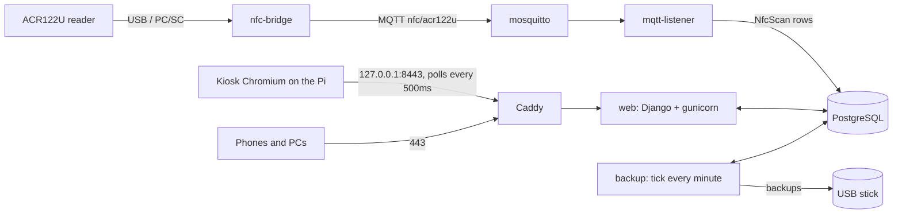
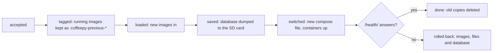
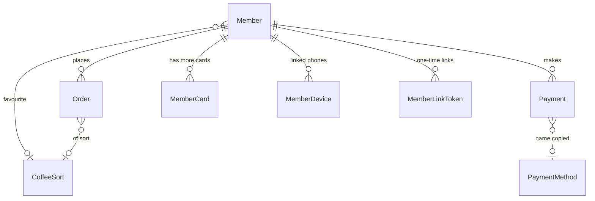
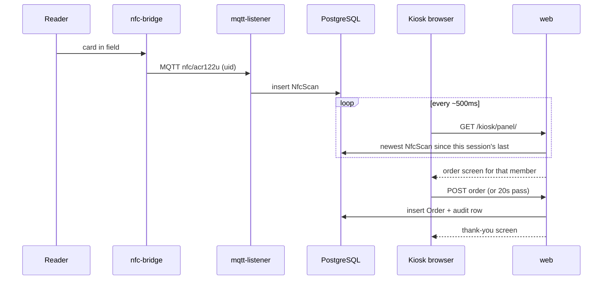

# Architecture

How CoffeePy is put together: the device and what runs on it (the system), then the Django
project inside it (the software). How the numbers on the screens come about is in
[CALCULATIONS.md](CALCULATIONS.md); the non-obvious traps for whoever changes the code are in
[CLAUDE.md](../CLAUDE.md).

- [Overview](#overview)
- **System:** [Hardware](#hardware) · [Host](#the-host) · [Containers](#containers) ·
  [Network and HTTPS](#network-and-https) · [Backups](#backups) · [Offline updates](#offline-updates) ·
  [Maintenance screen](#maintenance-screen) · [System time](#system-time)
- **Software:** [The four apps](#the-four-apps) · [Data model](#data-model) ·
  [A card tap, end to end](#a-card-tap-end-to-end) · [Users and roles](#users-and-roles) ·
  [Audit log](#audit-log) · [Two languages](#two-languages) · [Project layout](#project-layout)

## Overview

CoffeePy V2 is a single Django project: Postgres instead of V1's SQLite, the Tkinter GUI and
Flask dashboard replaced by a touchscreen kiosk and an admin dashboard that both run as web
apps (HTMX), and NFC card reads delivered through the [`nfc-cardreader`](../nfc-cardreader/)
ACR122U→MQTT bridge. Everything ships via `docker compose`, including on a Raspberry Pi that
runs fully offline.

The browser on the touchscreen is just another client: it polls the app through Caddy, and
the app reads the card taps the bridge left in the database. No websockets, no Channels, no
Redis.

---

# System

## Hardware

| Part | Role |
|---|---|
| Raspberry Pi 3 or newer, ≥1 GB RAM | runs everything; a 1 GB Pi 3 is enough, with compressed swap |
| 1024×600 HDMI touchscreen | the kiosk; the mode is forced on the kernel command line (`video=`), see below |
| ACR122U NFC reader | the only supported reader; any MIFARE card or fob (ISO 14443A) |
| DS3231 RTC on I²C-1 | keeps the time without internet |
| USB stick | backups, set up in the dashboard |

The manual's [What you need](MANUAL.en.md#1-what-you-need) has the shopping list, the wiring
and what the device measurably needs (CPU, RAM, SD card, boot times).

### Housing

[housing/](../housing/) holds the desk housing carried over from V1 - it fits V2 unchanged,
since the hardware did not change:

- `housing/3D/` - STL files to print. `LCD_*` are the screen frame variants (`_H`
  horizontal, `_V` vertical, `_V_T1`/`_V_T2` the two-part vertical version), `Card_*` the
  card-reader holder in the matching orientations.
- `housing/labels/` - printable labels: the front badge, the screen frame and the type
  plate.

## The host

Raspberry Pi OS (Lite), set up by [`install/install.sh`](../install/install.sh) - see the
[Quickstart](QUICKSTART.md#install-it-on-a-raspberry-pi). The containers can't touch hardware,
block devices or the host's services, so the host carries a few small helpers of its own. They
talk to the app through files under `/opt/coffeepy/data/`, never through Docker or the network.

| Unit | What it does |
|---|---|
| `coffeepy.service` | the `docker compose` stack |
| `coffeepy-storage.service` | `install/storage_helper.py`: sees USB sticks, formats/adopts/ejects the backup stick on the dashboard's request (`data/storage/`); also switches SSH on and off (dashboard → System) |
| `coffeepy-update-watcher.service` | `install/update_watcher.py`: picks up uploaded update bundles and applies them ([Offline updates](#offline-updates)) |
| `coffeepy-update-recover.service` | before the stack starts: puts back an update a power cut interrupted |
| `coffeepy-watchdog.timer` | every minute: restarts the kiosk session if its browser stopped polling, the stack if `/health/` stops answering - at most three times an hour |
| `coffeepy-rtc-sync.timer` | every 10 minutes: writes a corrected system clock to the DS3231 |

Also installed: the kiosk session (autologin on tty1, X, Openbox, Chromium in kiosk mode,
which trusts the device CA through its NSS store), the night rest that turns the screen off
at set hours, the CoffeePy boot splash, the ACR122U udev rule plus the blacklist that keeps
the kernel's `pn533` driver off the reader, and - optionally - a WiFi access point
(hostapd + dnsmasq on `192.168.4.1`, channel picked at every start) for the phones.

The display mode is pinned for the documented 1024x600 panel. Current Raspberry Pi OS drives
HDMI through KMS, where the classic `hdmi_group`/`hdmi_mode`/`hdmi_cvt` settings are ignored
and a panel with no usable EDID simply stays black - hence `video=` on the kernel command line.

## Containers

| Service        | What it does |
|----------------|--------------|
| `db`           | PostgreSQL 16 |
| `mosquitto`    | MQTT broker |
| `nfc-bridge`   | The ACR122U→MQTT bridge (see [nfc-cardreader/](../nfc-cardreader/)) - publishes every card on `nfc/acr122u`, the reader's state on `nfc/acr122u/status` |
| `migrate`      | One-shot `manage.py prepare --tls` (migrate, initial admin, certificates) - the only container that migrates; gates startup of the services below |
| `web`          | Django (gunicorn, `GUNICORN_WORKERS` workers): kiosk (`/kiosk/`), dashboard (`/dashboard/`), phone portal (`/portal/`) |
| `caddy`        | The only way in: HTTPS on 443, and the kiosk on 127.0.0.1:8443 (see [Network and HTTPS](#network-and-https)) |
| `mqtt-listener`| Subscribes to the bridge's topics, writes `NfcScan` rows and the reader status |
| `backup`       | Every minute `manage.py tick`: corrects a clock that went back, and backs the device up to the stick when the interval set in the dashboard is over; hourly the audit housekeeping |

`migrate`, `web`, `mqtt-listener` and `backup` share one image, `coffeepy-web`. Templates
and static files are baked into it at build time (`collectstatic` runs in the Dockerfile).

## Network and HTTPS

Nothing reaches the app except through Caddy: port 443 for the network, and
`127.0.0.1:8443` for the kiosk's own browser - the one place `/kiosk/` is served, so the
touchscreen UI can't be opened from anywhere but the device itself. Port 80 and the app's
own port 8000 are not published at all.

- **On first start** the stack creates its own CA (10 years) and signs the network
  certificate with it, for `PUBLIC_HOST`, `192.168.4.1` and `coffeepy.local`
  (`TLS_EXTRA_HOSTNAMES` in `.env`). Everything lives in `data/tls/` on the host; the
  installer never touches it on a re-run. Certificates are renewed automatically before
  they expire, and re-issued when the names change - the CA stays, so phones keep trusting it.
- **Phones and PCs** install the CA once from `/certificate/` - linked, without a login,
  on the dashboard and portal pages - and the browser warning is gone for good. On an
  iPhone it then also has to be enabled under *Settings › General › About › Certificate
  Trust Settings*.
- **Your own certificate** (PEM, chain included, plus its unencrypted key) can be uploaded
  at `/dashboard/certificate/` (superuser only) and replaces the network certificate within
  seconds; a button goes back to the self-signed one. The kiosk keeps the device's own
  certificate regardless, so a bad upload can never lock the touchscreen out.

`dashboard/tls.py` explains the moving parts: it writes the certificates and the Caddyfile,
named after their own hash so Caddy's `--watch` reloads them. Rootless Podman can't bind
port 443 by default - allow it with `sysctl net.ipv4.ip_unprivileged_port_start=443`.

### Reachable address for QR codes

Anything meant to be opened from a *different* device (the dashboard/link-your-phone QR
codes on the kiosk) needs an address that device can actually reach - not "localhost",
which is what the kiosk's own browser sees since it and the app run on the same machine.
`PUBLIC_HOST` in `.env` controls this, and is automatically added to
`DJANGO_ALLOWED_HOSTS` so Django doesn't reject requests through it. The provisioning tool
and `install/install.sh` set it - to the Pi's own WiFi AP (`192.168.4.1`), or without the AP
to the address the host's default route leaves from. Left empty (a plain `docker compose up`
on a PC), autodetection runs *inside* the `web` container and normally finds the container's
own bridge-network IP, which no phone reaches: set `PUBLIC_HOST` to your host's LAN IP. The
dashboard's System page says so while the address is only a guess.

`/dashboard/system/` (superuser only) shows that address alongside live CPU, RAM and disk
usage (via `psutil`) - handy for keeping an eye on a resource-constrained Pi.

## Backups

Backups go to a USB stick that an admin sets up under `/dashboard/backup/`: the host service
`coffeepy-storage` (`install/storage_helper.py`) formats it (ext4, label `COFFEEBAK`), marks it
with this device's id and remembers it. From then on the `backup` service writes the whole
device to it at the interval set on that page - database (`pg_dump --format=custom`), device
CA and certificates, settings -, optionally encrypted with `BACKUP_PASSPHRASE`, read back and
checksummed, and thinned out by generations (newest, daily, weekly, monthly). Pulled out,
backups pause (the dashboard's overview and the kiosk say so) and resume when the same stick
comes back. The same page restores a backup - all of it or parts, from the stick, another
device's stick, or an uploaded file, older `.sql` dumps included - and downloads one without
a stick.

How it holds together:

- **Only the one stick is written.** Its metadata must carry this device's id and the stick's
  own id; an older stick of the same device is read-only. While no stick is in, the mount point
  is a plain directory on the SD card - nothing writes there without checking first.
- **One backup is one file**, `coffeepy_<time>.backup`: a tar with `manifest.json` (time, app
  version, migrations, device), `database.dump` and `config/` (`.env`, the device CA and
  certificates, the device id, which stick it backs up to) - what a replacement device needs.
  With a passphrase it is AES-256 (PBKDF2) through `openssl` and named `.backup.enc`. Every
  backup has a `.sha256` next to it.
- **A restore saves the current state first** (`before-restore_*`, onto the stick), then
  replaces the database in one transaction - a broken backup rolls back instead of leaving an
  empty database - and migrates it to the running version. That is how a backup of an older
  version comes back on a newer one.
- **A restore replaces the dashboard logins too**, so the restoring admin may be logged out.

`coffee/backups.py` is the app side; the manual's [Backups](MANUAL.en.md#backups) is the
admin's side.

## Offline updates

The Pi is meant to run without internet, so updates are pushed manually instead of pulled:

1. On a dev machine with internet: `./scripts/update_builder.sh` (guided) or
   `./scripts/build_update_bundle.sh [--platform linux/arm64]` builds and signs a bundle of
   every image `docker-compose.yml` defines for the Pi's architecture - `coffeepy-web`
   (shared by `migrate`/`web`/`mqtt-listener`/`backup`) and `nfc-bridge` (its own
   Dockerfile under [nfc-cardreader/](../nfc-cardreader/)) - plus pulls `db`/`mosquitto`/`caddy`,
   and bundles them together with `docker-compose.yml` itself into one `.tar`. The
   compose file is the only source of truth for what's in the bundle *and* what runs on
   the Pi, so the two can't quietly fall out of sync - and shipping it is how you add a
   whole new container (a new service block), not just update existing ones.
   Or take the bundle from a GitHub release and sign it with `sign_update_bundle.sh` and your
   own key ([CI.md](CI.md#signed-bundles---the-path-for-a-device-in-use)) - the
   release's bundle is unsigned, and installing it as it is needs the signature check off,
   which is for development only.
2. Carry it over (USB stick, or a laptop joined to the Pi's own WiFi AP) and upload it at
   `/dashboard/update/` (superuser only).
3. A host-level systemd service (`coffeepy-update-watcher.service`,
   `install/update_watcher.py`) checks the signature (against `install/update-signing.pub`,
   or a device's own key - see the manual's "Your own signing key"), every file's checksum,
   platform, space and version; saves the database and the running images to the SD card;
   `docker load`s the images, drops in the new `docker-compose.yml` and runs
   `docker compose up -d --remove-orphans`. If `/health/` doesn't answer afterwards, it
   rolls everything back by itself. The web container itself never gets Docker/host access.

What makes it safe to run unattended:

- **A journal before every step** (`data/updates/journal.json`). A power cut mid-update is
  caught at the next boot by `coffeepy-update-recover.service`, before the stack starts: it
  puts the old version back - database included once the update had switched - and the bundle
  into `incoming/` again. At most three attempts.
- **The dump is checked** (gzipped plain SQL, pg_dump's closing line) before anything relies
  on it, and loaded back as a whole: psql would commit a dump cut off mid-data.
- **Updates only go forward.** A bundle older than what is installed is refused; once a new
  version came up, the copies for the way back are deleted - a version that came up is fixed
  by the next update. The one way back the check lets through is a pre-release (a SemVer with a
  `-`) to a release of the same major version; migrations the release doesn't know are
  reversed first, by the running image.
- **A new `.env` setting** reaches existing devices through `env_defaults` in the manifest
  (taken from `.env.example`).
- The watcher also runs the installer's `hardware`, `services` and `kiosk` steps from the
  bundle, so a host-side change (a new unit, a kiosk fix) arrives with the update.

### Operating system updates

The images carry the app; the host's own packages - kernel, firmware, Chromium, OpenSSH,
Docker - are Raspberry Pi OS's. An offline device gets their updates through an **OS bundle**,
which goes the same way as an app bundle: built on a machine with internet
(`scripts/build_os_bundle.sh --packages LIST`), signed with `sign_update_bundle.sh`, uploaded
on the update page. Its manifest says `"kind": "os"`; it holds the packages (`os.tar`, resolved
against the Raspberry Pi OS archives with their whole dependency closure) and the one script
that installs them, `install/os_update.sh`, signed along with them. That script only updates
what is installed, keeps the device's configuration files and asks for a restart when kernel,
firmware, libc or systemd changed.

The watcher checks it like an app bundle - plus that the device runs the bundle's OS release,
and against the last OS bundle (`os-installed.json`) rather than the app's version - saves the
database, runs the script, restarts the device if asked to (the maintenance screen stays up
across it) and waits for `/health/`. There is no rollback: apt has none. A power cut in the
middle leaves dpkg half done, which `coffeepy-update-recover.service` finishes at the next boot
(`dpkg --configure -a`); uploading the bundle again completes it.

Which packages go in is the operator's decision: CoffeePy runs on more than one kind of
hardware. The update page offers the device's installed packages (`os-packages.txt`, refreshed
by the watcher) as the list to start from - SSH is off on a device in use.

## Maintenance screen

The installer and the update watcher write their progress to `data/maintenance/status.json`.
Caddy serves that file itself, so the kiosk can read it while the app is down and cover the
screen with "We'll be right back" and the current step until it is over; Caddy answers a 502
with a maintenance page of its own. When the status ends, the kiosk reloads. Update, restore
and import check this file to never run at the same time.

## System time

The device usually has no internet and therefore no NTP. `install/install.sh` enables the
DS3231 RTC overlay, so the kernel reads the time at boot; `coffeepy-rtc-sync.timer` writes a
corrected clock back to the module (only for a step of more than a minute, so the accurate RTC
doesn't inherit the Pi's drift) and reports its health to `data/storage/rtc.json` - the
kiosk's red clock sign, the overview's "Clock module" row. A clock that is plausible but wrong
is put forward by `coffee/clock.py` in the backup service's minutely tick: when it went back
within a boot or stands behind the newest audit entry - never back, and not at all once NTP
set it.

`/dashboard/system-time/` (superuser only) is the offline fallback if the RTC drifts or
isn't fitted - normally `install/install.sh` enables the DS3231 RTC overlay so NTP
isn't needed at all.

---

# Software

## The four apps

| App | Who looks at it | Auth |
|---|---|---|
| `coffee/` | nobody - models, `services.py` (all aggregate queries), management commands | - |
| `kiosk/` | the touchscreen next to the machine | NFC card tap, session only |
| `dashboard/` | admins, on a phone or PC | Django auth, two roles (below) |
| `portal/` | members, on their own phone | a one-time link from a kiosk QR code, then a rolling 6-month session |

**The kiosk** (`/kiosk/`) is an HTMX page whose `#panel` is re-fetched about every 500ms, so a
card tap shows up at once. Its screens - order, pay, settings, ranking - are server-rendered
states of one session: a tap logs the member in, a nav button or 20s without a touch logs them
out. Two consequences shape the code: a screen whose animation must keep playing has to render
byte-identically from poll to poll (a client-side script skips identical swaps), and anything
expensive behind a polled screen is cached - the ranking against
`services.ranking_fingerprint()`. Ranking and pillory are optional (`KioskBoards`, off on a new
device).

**The dashboard** (`/dashboard/`) is plain Django views and templates; sidebar, phone tabs and
the "More" sheet are all drawn from one list (`dashboard/templatetags/dashboard_nav.py`). There
is no Django admin (`/admin/` doesn't exist): members, bookings, users and settings all have
their own pages.

**The portal** (`/portal/`) shows a member their balance, payments, cards, linked devices and
how their habits compare with everyone else's. A linked phone is a `MemberDevice` row next to
its session, so it can be revoked from the phone, the kiosk or the dashboard.

## Data model

| Model | Notes |
|---|---|
| `Member` | primary key is the card's uid; a name like "Anna B." (`coffee/names.py`); `departed_at` takes them out of rankings and the pillory |
| `MemberCard` | additional cards of a member; `AltUidCapture` arms the kiosk to link the next tap |
| `CoffeeSort` | name, price, machine strokes (a jug is two) |
| `Order` | member, sort, `value` and `machine_strokes` copied from the sort at the time of the order, `created_at` |
| `Payment` | member, value, method name ("Cash" or a `PaymentMethod`'s name - stored, so renaming a method doesn't rewrite history) |
| `PaymentMethod` | PayPal, a pool, WERO or a custom link with `{amount}` |
| `NfcScan`, `NfcReaderStatus` | what the bridge reported, written by `mqtt-listener` |
| `AuditLogEntry` | the audit log (below) |
| `BackupSettings`, and in `dashboard`: `PasswordPolicy`, `NamePolicy`, `NightPolicy`, `KioskBoards`, `AccountSecurity` | settings that live in the database, so a backup carries them |

Every ranking, statistic and comparison counts **cups as machine strokes**, not order rows -
see [CALCULATIONS.md](CALCULATIONS.md).

## A card tap, end to end

An unknown card starts a new member, who is asked for a name first; a name that fails today's
rules sends the member to the name screen before the order. Taps during the night rest are
never booked: every page load starts at the newest scan.

## Users and roles

The dashboard uses Django's built-in auth with two roles - admins (superusers: everything,
including the system pages and the dashboard's own user management) and managers (members,
bookings, coffee sorts, payment methods). Single orders and payments are corrected under
"Bookings", each change with an audit-log entry. The login rules (length, lockout, idle
logout) live in the database ("Login & passwords"); failed logins are counted in the audit
log, so a lockout survives a restart.

Members have no password at all: the kiosk knows them by their card, the portal by the
session a one-time link created.

## Audit log

Everything that changes data writes an `AuditLogEntry` right after the change succeeded - in
the dashboard, the kiosk and the portal alike (the latter two name the member as the actor) -
with the source and the client address; failures are logged with `outcome="failure"`.
Background work logs as itself; the host's processes append to `data/storage/events.jsonl`,
which the `backup` service moves into the log hourly. Entries older than
`AUDIT_RETENTION_DAYS` are removed.

## Two languages

Every screen exists in German and English. Which one a device shows is its own cookie (the
kiosk's DE/EN button, the switch in dashboard and portal), or else the default chosen at
setup - never the browser's language. The message ids are the English text; stored text
(the thank-you message, error messages kept in the database, "Cash") is stored in English and
translated where it is shown.

## Project layout

- `coffee/` - models (`CoffeeSort`, `Member`, `Order`, `Payment`, `NfcScan`, ...), the ORM
  query layer (`services.py`), backups, clock and RTC, and management commands
  (`mqtt_listener`, `import_sqlite`, `backup_db`, `tick`, `prepare`).
- `kiosk/` - the touchscreen order/settings/pay/ranking UI.
- `dashboard/` - admin auth, statistics, pillory, exports, backup/update/system-time,
  certificates, the audit log.
- `portal/` - the member-facing phone view (balance, pay, own stats, cards, devices),
  reached by scanning the kiosk's "Link this phone" QR code.
- `config/` - settings, URLs, language selection.
- `install/` - `install.sh` (the whole device setup), systemd units, udev rules,
  hostapd/dnsmasq templates, kiosk session files, update watcher, storage helper.
- `scripts/` - `provision.sh` (the guided setup from a PC), `build_update_bundle.sh` and
  `update_builder.sh` (dev-machine side of the offline update pipeline),
  `build_offline_bundle.sh` (full no-internet install bundle), and the generators of the
  kiosk's icons and animations.
- `nfc-cardreader/` - ACR122U→MQTT bridge, unchanged from V1.
- `docs/` - this documentation, the manual in [English](MANUAL.en.md) and
  [German](MANUAL.de.md) with its screenshots under `pictures/manual/`, and `pictures/` the
  images the README shows.
- `housing/` - STL files and labels for the desk housing ([Housing](#housing)).
