# CoffeePy – Bedienungsanleitung

*[English version](MANUAL.en.md)*

CoffeePy ist eine Strichliste für die gemeinsame Kaffeemaschine – nur ohne Zettel: Wer sich
einen Kaffee nimmt, hält seine Karte an die markierte Stelle und tippt auf dem
Touchscreen an, was er trinkt. CoffeePy rechnet mit, zeigt jedem seinen Kontostand, nimmt
Zahlungen an und hat für die Verwaltung ein Dashboard im Browser. Mitglieder können ihr Handy
verknüpfen und sehen dort ihre Statistik und zahlen.

> **Kein Kassensystem.** CoffeePy ersetzt nur den Papierzettel als Strichliste. Es ist keine
> Kasse und verkauft nichts: keine Belege, keine Steuern, keine manipulationssicheren
> Aufzeichnungen (keine TSE nach KassenSichV, keine GoBD-konforme Buchführung) und keine
> Zahlungsabwicklung – eine Zahlung, die am Kiosk oder am Handy eingetragen wird, ist ein
> Vermerk, dass jemand nach eigener Angabe bezahlt hat, und die Bezahl-Links öffnen nur die
> eigene App des Mitglieds. Die Kontostände sind eine formlose Strichliste unter denen, die sich
> die Maschine teilen – so wie vorher der Zettel. Wo Kaffee gewerblich verkauft wird, braucht es
> ein richtiges Kassensystem. CoffeePy kommt ohne jede Gewährleistung (siehe
> [LICENSE](../LICENSE)).
>
> **Keine Haftung.** Soweit gesetzlich zulässig, übernehmen die Autoren keine Haftung für
> Schäden jeder Art, die aus der Installation oder Nutzung von CoffeePy entstehen – unter
> anderem verlorene oder falsche Daten und Kontostände, offene oder bezahlte Beträge, Streit
> unter Mitgliedern, fehlgeschlagene Backups oder Updates, Schäden am Raspberry Pi, am
> Kartenleser, an der Kaffeemaschine oder an angeschlossenen Geräten sowie Datenverlust auf der
> SD-Karte oder dem Backup-Stick. Wer CoffeePy betreibt, ist selbst dafür verantwortlich, die
> Kontostände zu prüfen, Backups aufzubewahren und die Hardware sicher zu betreiben. Die
> Haftung für Vorsatz, grobe Fahrlässigkeit und für Schäden an Leben, Körper oder Gesundheit
> bleibt unberührt, soweit das Gesetz sie nicht ausschließen lässt.

Diese Anleitung erklärt alle Oberflächen. Technische Details (Aufbau, Entwicklung, Interna)
stehen in der [README](../README.md).

**Inhalt**

1. [Was du brauchst](#1-was-du-brauchst)
2. [Installation](#2-installation)
3. [Erste Schritte](#3-erste-schritte)
4. [Der Kiosk](#4-der-kiosk)
5. [Das Handy-Portal](#5-das-handy-portal)
6. [Das Dashboard](#6-das-dashboard)
7. [Betrieb und Wartung](#7-betrieb-und-wartung)
8. [Wenn etwas nicht klappt](#8-wenn-etwas-nicht-klappt)

---

## 1. Was du brauchst

| Teil | Hinweise |
|---|---|
| Raspberry Pi | **3 Model B oder neuer** (3, 3+, 4, 5, Zero 2 W). Ein Pi 3 mit 1 GB reicht; ein Pi 4 mit 2 GB+ hat mehr Reserven. |
| microSD-Karte | 16 GB oder mehr, möglichst A1/A2 – das ist die Systemplatte. |
| Netzteil | Das offizielle Netzteil für dein Modell. Billige Netzteile sind die häufigste Ursache für wackelige USB-Geräte und Touchscreens. |
| Touchscreen | 1024×600 (z. B. [Adafruit #2396](https://www.adafruit.com/product/2396)). Das offizielle 7"-Display (800×480) funktioniert ebenfalls. |
| NFC-Leser | **ACR122U** von Advanced Card Systems – der einzige unterstützte Leser. |
| Echtzeituhr | **DS3231**-Modul mit CR2032-Batterie, damit der Pi auch ohne Internet die richtige Uhrzeit hat. Anschluss an I²C-1: VCC→Pin 1, GND→Pin 6, SDA→Pin 3, SCL→Pin 5. CoffeePy prüft es regelmäßig und warnt, wenn es fehlt, nicht antwortet oder die Zeit verloren hat. **Die Batterie alle zwei bis drei Jahre tauschen**, auch ohne Warnung (siehe [Wenn etwas nicht klappt](#8-wenn-etwas-nicht-klappt)). |
| Karten | Beliebige MIFARE-Karten oder -Schlüsselanhänger (ISO 14443A) – eine pro Mitglied. Viele Firmen- oder Fahrkarten funktionieren auch. |
| USB-Stick (empfohlen) | Für automatische Backups. Vorzubereiten ist nichts: Du richtest ihn im Dashboard ein (siehe [Backups](#backups)) – dabei wird er gelöscht. |

### Gehäuse

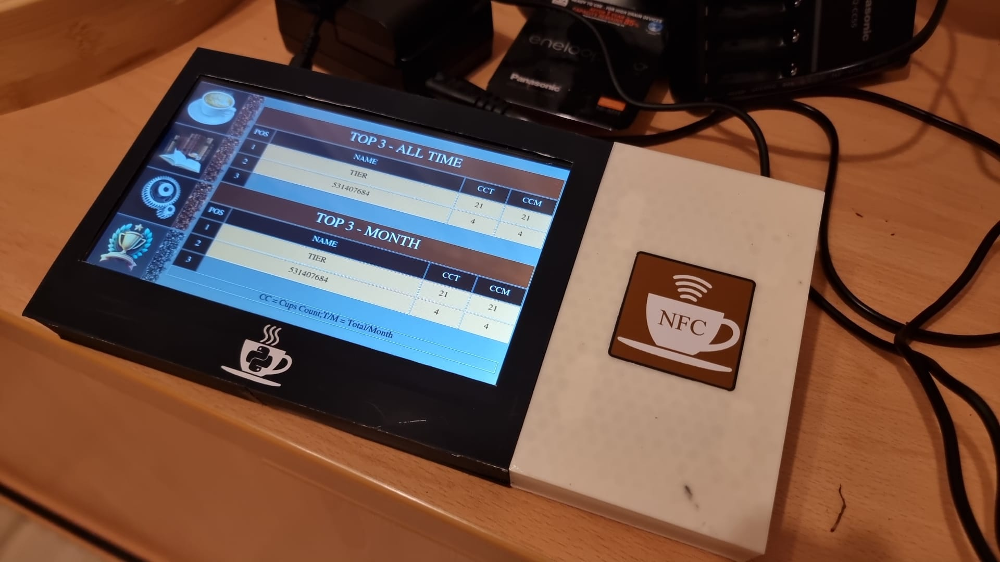

Ein 3D-druckbares Gehäuse für Pi, 1024×600-Display und Leser liegt in [housing/](../housing/):
die `LCD_*`-Rahmen und den passenden `Card_*`-Halter aus `housing/3D/` drucken (`_H` quer,
`_V` hochkant, `_V_T1`/`_V_T2` für Drucker, die den Rahmen in zwei Teilen brauchen), die
Aufkleber aus `housing/labels/` runden es ab. Jedes andere Gehäuse geht genauso.

---

## 2. Installation

Die Installation läuft von einem Linux-PC aus, mit dem **Provisioning-Tool**. Auf dem Pi
brauchst du nur ein frisches **Raspberry Pi OS** mit eingeschaltetem SSH.

### Den Pi vorbereiten

1. Mit dem [Raspberry Pi Imager](https://www.raspberrypi.com/software/) **Raspberry Pi OS
   Lite (64-bit)** auf die SD-Karte schreiben.
2. In den Einstellungen des Imagers einen **Benutzernamen und ein Passwort** festlegen und
   **SSH einschalten**. Für die Installation braucht der Pi Internet – am einfachsten per
   Netzwerkkabel, sonst trägst du dort dein WLAN ein.
3. Karte einsetzen, Display, Leser und Uhr anschließen, Pi starten.

> Ein Netzwerkkabel ist die bessere Wahl: Am Ende richtet CoffeePy auf Wunsch ein eigenes
> WLAN ein, und eine Verbindung über das bisherige WLAN des Pi bricht dann ab.

### Das Provisioning-Tool

Im CoffeePy-Verzeichnis auf deinem PC:

```bash
./scripts/provision.sh
```

Das Tool braucht nur Bash, SSH und tar, und es verändert an deinem PC nichts. Bedient wird
es mit den Pfeiltasten, **Enter** und **Esc**.

**Sprache.** Zuerst wählst du die Sprache des Tools. Sie ist auch der Vorschlag für die
Standardsprache des Geräts.

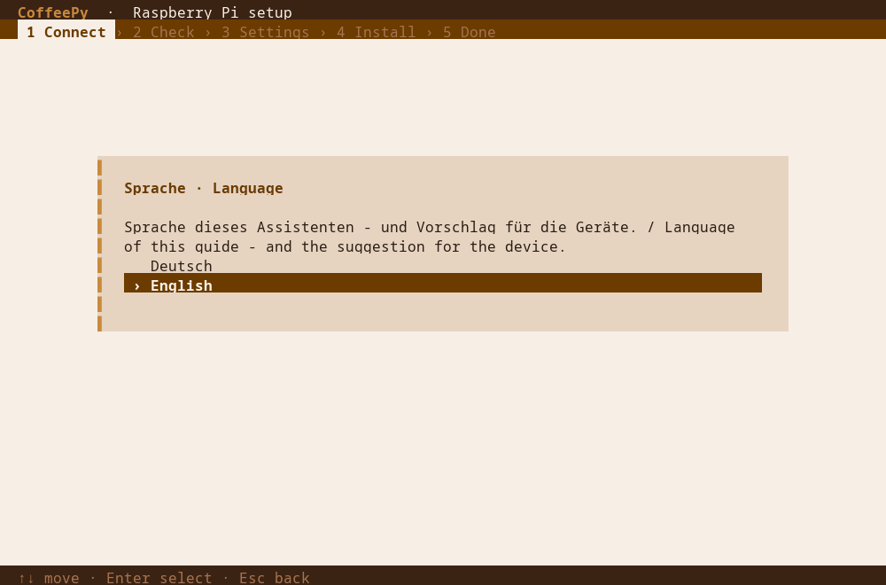

**Begrüßung**, danach die **Adresse des Pi** (wie dein Router sie anzeigt, oder
`raspberrypi.local`), der **Benutzer** und sein **Passwort** aus dem Imager. Das Passwort
wird nur im Speicher gehalten und nirgends gespeichert.

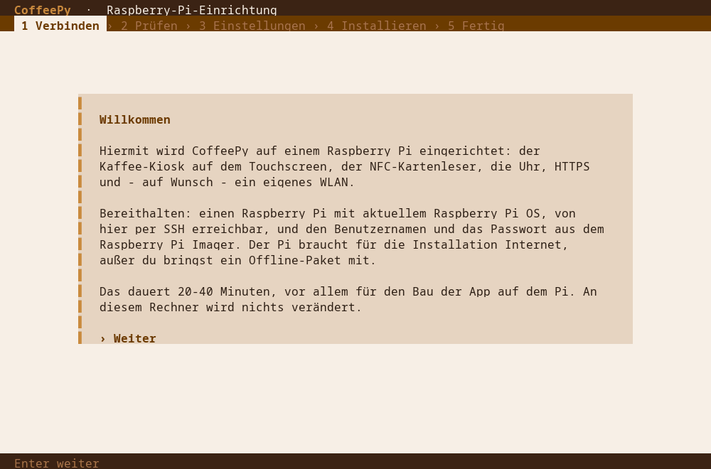

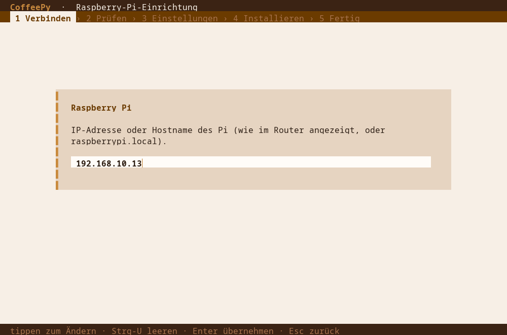

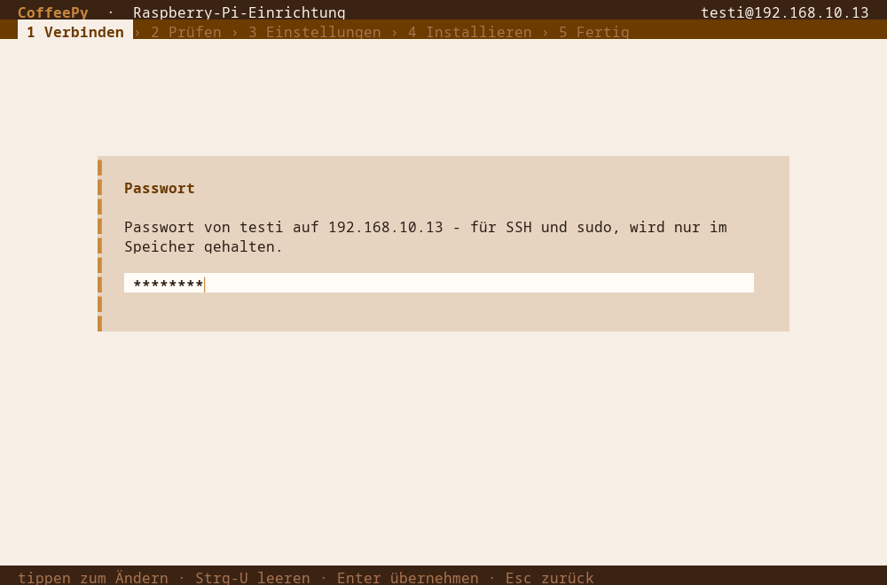

**Pi prüfen.** Das Tool zeigt Modell, System, Speicher, ob der Pi Internet hat und über welche
Verbindung du verbunden bist – und warnt, wenn etwas nicht passt (zu wenig Speicher, kein
Internet, Verbindung über das WLAN des Pi).

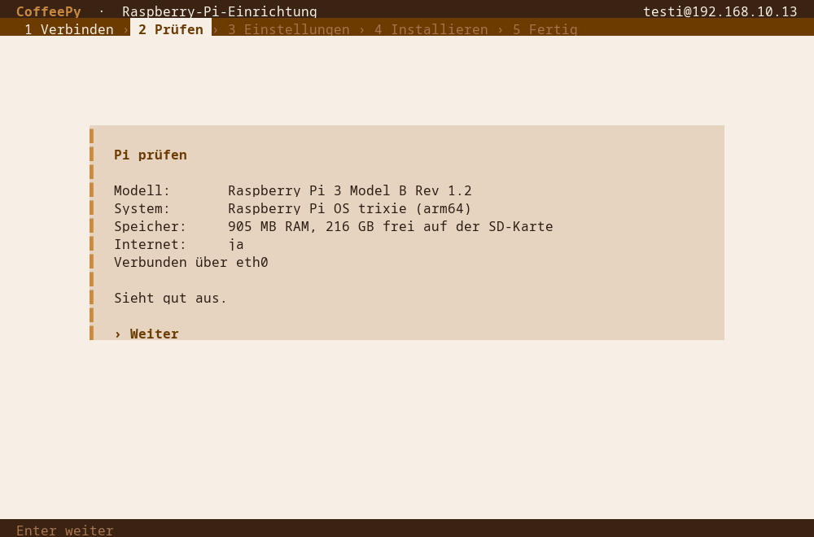

Ist CoffeePy auf dem Pi schon installiert, sagt das Tool es und übernimmt dessen
Einstellungen als Vorgaben. Datenbankpasswort und interne Schlüssel bleiben dabei immer
erhalten – du kannst das Tool also jederzeit erneut laufen lassen, um Einstellungen zu ändern
oder eine neue Version einzuspielen.

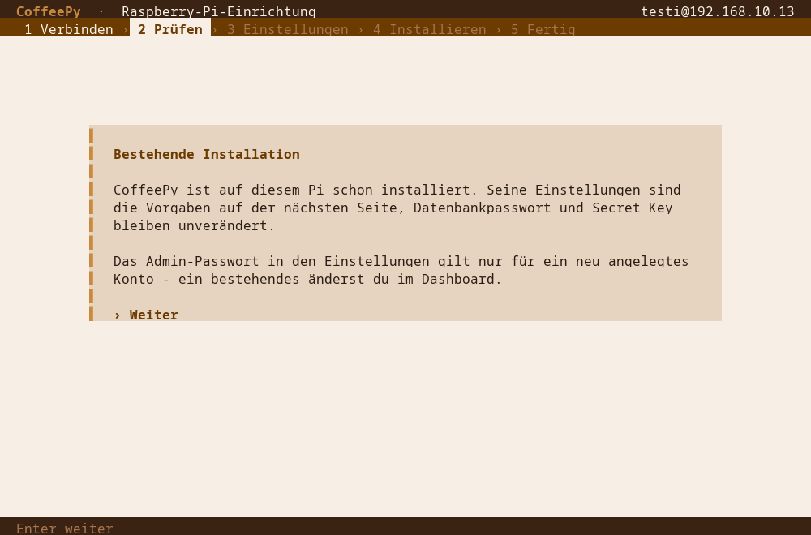

**Einstellungen.** Alles, was in die Konfiguration des Pi kommt, auf einer Seite. Eine Zeile
auswählen, um sie zu ändern:

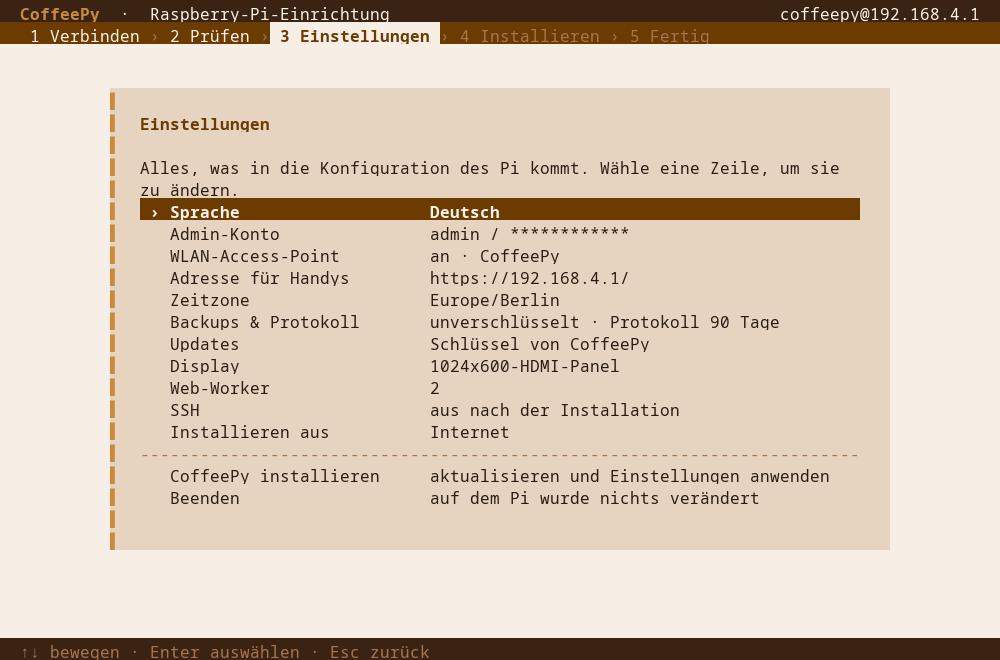

| Einstellung | Bedeutung |
|---|---|
| Sprache | Die Sprache, in der Kiosk, Dashboard und Portal starten. Jedes Gerät kann trotzdem selbst umschalten. |
| Admin-Konto | Benutzername und Passwort für das Dashboard. Vorgeschlagen wird ein zufälliges Passwort, das am Ende angezeigt wird. Gilt nur beim **ersten** Anlegen – ein bestehendes Konto änderst du im Dashboard. |
| WLAN-Access-Point | Der Pi spannt ein eigenes WLAN auf, über das Handys Dashboard und Portal erreichen. Ausschalten, wenn der Pi in deinem bestehenden Netz bleibt. Bei jedem Start wählt er den Kanal (1, 6 oder 11), den die Nachbarnetze am wenigsten stören, mit der höchsten erlaubten Sendeleistung. |
| Adresse für Handys | Die Adresse in den QR-Codes und im Zertifikat. Mit Access Point `192.168.4.1`, sonst die (am besten feste) Adresse des Pi in deinem Netz. |
| Zeitzone | Für die Uhr und die Statistiken nach Stunde und Wochentag. |
| Backups & Protokoll | Ob die Backups auf dem USB-Stick **verschlüsselt** werden (eine Passphrase mit mindestens 12 Zeichen – bewahre sie sicher auf, ohne sie lässt sich kein Backup wiederherstellen), und wie viele Tage das **Protokoll** aufbewahrt wird (standardmäßig 90). Wie oft gesichert wird, stellst du im Dashboard ein. |
| Updates | Welche **Signatur** ein Update tragen muss: Schlüssel von CoffeePy, **eigener Schlüssel** oder **keine Prüfung (nur Entwicklung)** (siehe [Eigener Signierschlüssel](#eigener-signierschlüssel)). |
| Display | Bildschirmmodus. Das dokumentierte 1024×600-Display meldet seine Auflösung nicht und braucht deshalb die Vorgabe. |
| Web-Worker | Prozesse für die Web-App: 2 für einen Pi 3, 3–4 für einen Pi 4 oder 5. |
| Installieren aus | Internet oder ein Offline-Paket (für Pis ohne Internet, siehe README). |

Eingaben werden sofort geprüft – zum Beispiel muss ein WLAN-Passwort mindestens 8 Zeichen
haben:

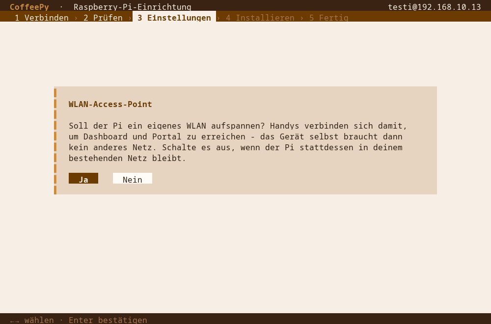

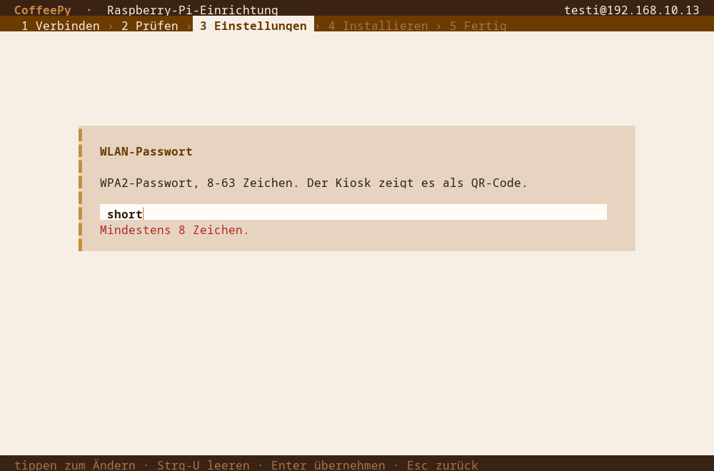

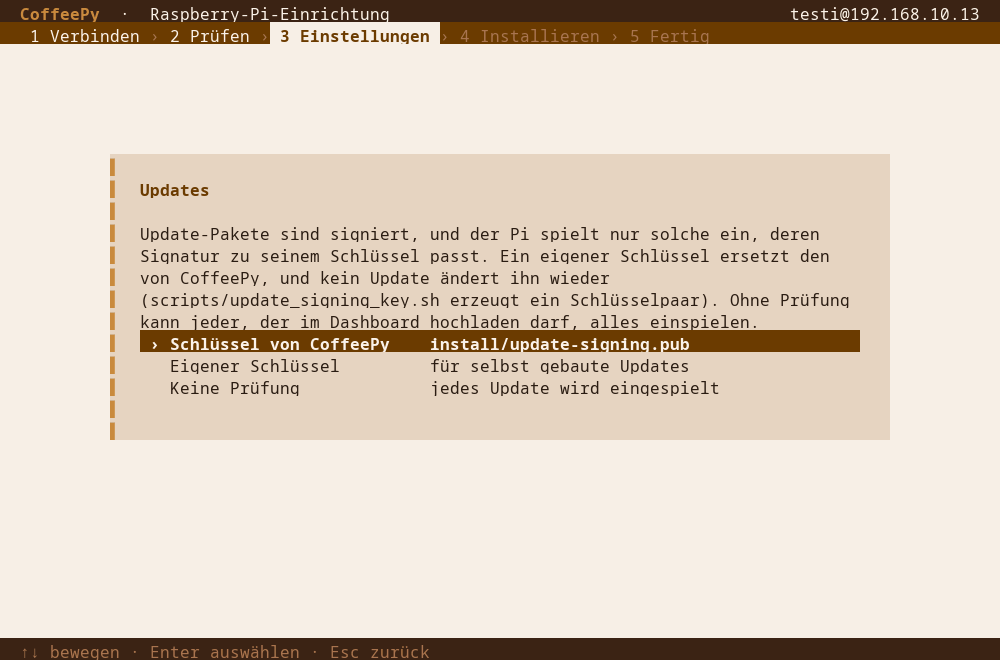

**Installieren.** Mit *CoffeePy installieren* geht es los. Die Installation läuft auf dem Pi
selbst, das Tool zeigt nur den Fortschritt – bricht die Verbindung ab oder schließt du das
Fenster, läuft sie trotzdem weiter. Das dauert 20–40 Minuten, vor allem für den Bau der App.

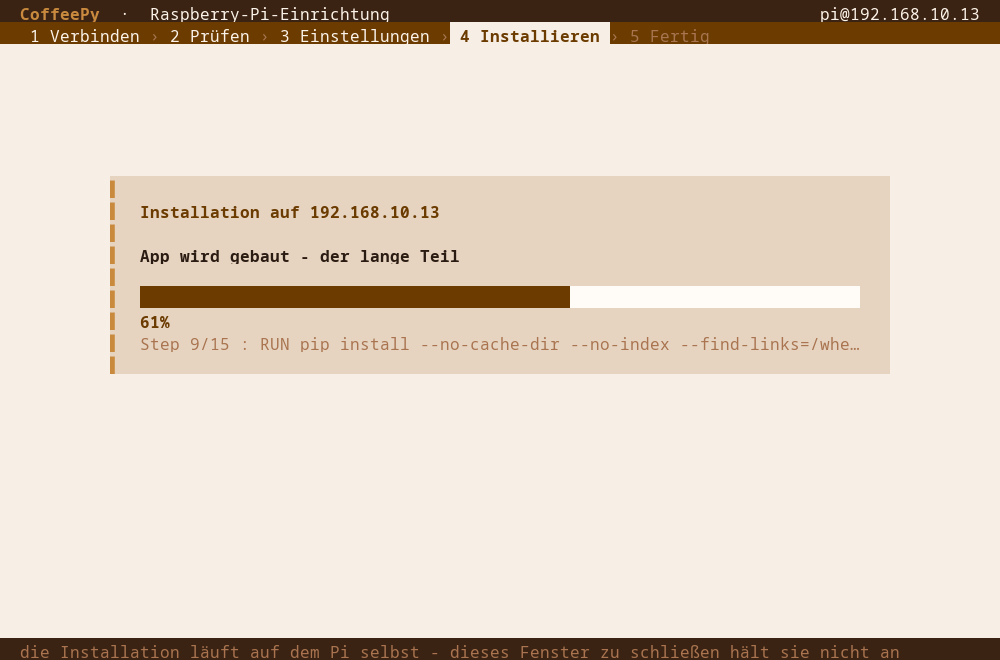

**Fertig.** Zum Schluss startet das Tool den Pi neu (Uhr, Display und Kiosk greifen erst
danach), prüft, ob CoffeePy über HTTPS antwortet, und zeigt die Zugangsdaten. Auf Wunsch
speichert es sie in einer Datei, die nur du lesen kannst.

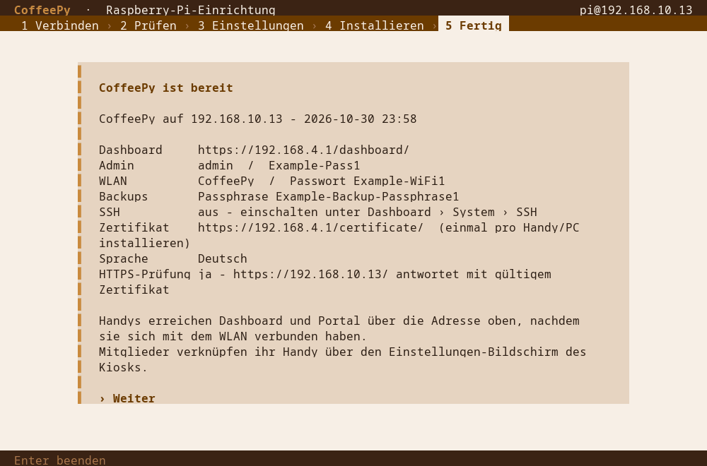

> **Für mehrere Geräte** lässt sich das Tool auch ohne Fragen betreiben:
> `./scripts/provision.sh --answers antworten.txt --unattended`. Welche Schlüssel die Datei
> kennt, steht am Anfang des Scripts.

---

## 3. Erste Schritte

### Mit dem Handy verbinden

Mit Access Point verbindest du dich mit dem WLAN **CoffeePy** (das Passwort zeigt das Tool am
Ende, und der Kiosk zeigt es als QR-Code, siehe [Admin-Zugang](#admin-zugang)). Danach
öffnest du `https://192.168.4.1/` – ohne Access Point die Adresse, die du bei der Einrichtung
angegeben hast.

### Das Zertifikat installieren

CoffeePy ist nur über HTTPS erreichbar. Das Zertifikat signiert das Gerät selbst, deshalb
warnt der Browser beim ersten Besuch. Damit die Warnung verschwindet, installierst du einmal
pro Handy oder PC das **Gerätezertifikat**: Es ist auf der Anmeldeseite und im Portal unter
*Zertifikat herunterladen* verlinkt (direkt: `https://192.168.4.1/certificate/`).

- **iPhone/iPad:** Datei öffnen → *Einstellungen › Profil geladen* installieren → danach unter
  *Einstellungen › Allgemein › Info › Zertifikatsvertrauenseinstellungen* das CoffeePy-Zertifikat
  einschalten.
- **Android:** *Einstellungen › Sicherheit › Weitere Einstellungen › Zertifikat installieren ›
  CA-Zertifikat* und die heruntergeladene Datei auswählen.
- **Windows:** Datei öffnen → *Zertifikat installieren* → Speicherort *Vertrauenswürdige
  Stammzertifizierungsstellen*.
- **macOS:** Datei öffnen (Schlüsselbundverwaltung) → Zertifikat doppelklicken → *Vertrauen:
  Immer vertrauen*.

Hast du im Dashboard ein eigenes Zertifikat hinterlegt (siehe [Zertifikat](#zertifikat)),
entfällt das, wenn es von einer Stelle stammt, der deine Geräte ohnehin vertrauen.

### Im Dashboard anmelden

Öffne `https://192.168.4.1/` und melde dich mit dem Admin-Konto an. Die Sprache schaltest du
unter dem Anmeldeformular um, später mit **DE/EN** oben rechts. Erfüllt das Passwort die
[Anmelderegeln](#anmeldung--passwörter) nicht (mehr), fragt das Dashboard gleich nach der
Anmeldung nach einem neuen.

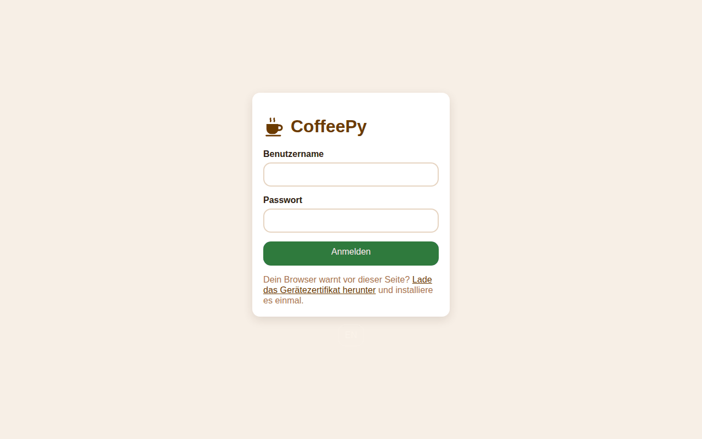

### Einrichten

Bevor der Kiosk Bestellungen annimmt, braucht er mindestens eine **Kaffeesorte** – solange
keine angelegt ist, zeigt er *Einrichtung nötig* mit QR-Codes zu WLAN und Dashboard.

1. **Kaffeesorten** anlegen: Name, Preis und Bezüge (wie viele Tassen die Maschine dafür
   ausgibt – eine Kanne zählt zwei).
2. Optional **Zahlungsmethoden** anlegen (PayPal, PayPal Pool, WERO oder ein eigener Link).
   Bar geht immer.
3. **Mitglieder** musst du nicht anlegen: Eine unbekannte Karte führt am Kiosk automatisch
   zur Anmeldung mit Namen (siehe [Einstellungen](#einstellungen)).
4. Einen **USB-Stick** einstecken und unter **Backup** einrichten – ab dann sichert sich das
   Gerät selbst (siehe [Backups](#backups)).

### Umstieg von Version 1

Ersetzt CoffeePy ein Gerät mit der alten Version 1, übernimmst du dessen Daten einmal – am
besten am Ende eines Tages, an dem nicht mehr gebucht wird:

1. **Die Datenbank vom laufenden Gerät nehmen, nicht von einer Kopie.** Das alte Gerät
   ausschalten, nachdem die letzte Buchung gemacht ist. Die Daten liegen auf seiner SD-Karte
   in `/home/<Benutzer>/CoffeePy/coffee.db`; ein Linux-Rechner liest die Karte direkt, oder
   du holst die Datei vorher per SSH. Eine ältere Kopie oder ein Backup vom alten Stick ist
   nur ein Notbehelf: Was danach gebucht wurde, fehlt sonst.
2. Im Dashboard unter **Alte Datenbank importieren** die Datei hochladen und **Vorhandene
   Mitglieder, Karten, … zuerst löschen** ankreuzen – sonst landen Probebuchungen und ein
   zweiter Import doppelt im Bestand.
3. Unter **Buchungen** die neuesten Einträge ansehen: Stimmen sie mit dem letzten Tag am
   alten Gerät überein, ist alles da.
4. **Uhrzeit prüfen** (Dashboard → **Systemzeit**). Das Uhrenmodul kommt meist mit
   herüber, und mit ihm die Uhrzeit des alten Geräts – die nach langem Betrieb ohne Netz
   falsch sein kann.
5. **Handys neu verbinden:** Das WLAN hat einen neuen Namen und ein neues Passwort, und jedes
   Handy braucht das [Zertifikat](#das-zertifikat-installieren).
6. **Neue Namen ankündigen:** Wer nicht schon „Vorname X.“ oder ein Kürzel wie „AB“ als Namen
   hat – bei der Version 1 fast niemand –, wird beim ersten Kaffee am neuen Gerät nach einem
   Namen gefragt (siehe
   [Einstellungen](#einstellungen)). Das dauert am Touchscreen eine halbe Minute; ein Hinweis
   vorab erspart Verwunderung in der Schlange.
7. Einen **Backup-Stick** einrichten (siehe [Backups](#backups)). Der Stick des alten Geräts
   wird dabei gelöscht – willst du seine Backups behalten, nimm einen neuen.

Die SD-Karte des alten Geräts aufzuheben, bis die ersten Wochen gut gelaufen sind, kostet
nichts.

---

## 4. Der Kiosk

Der Touchscreen hat vier Bereiche, links in der Leiste. Oben rechts sitzen runde Knöpfe: Der
**Schraubenschlüssel** ist der [Admin-Zugang](#admin-zugang) – für Mitglieder ist er nicht
gedacht –, **DE/EN** schaltet die Sprache des Kiosks um, und ein **rot blinkender** Knopf
erscheint, wenn am Gerät etwas zu tun ist:

| Zeichen | Bedeutung |
|---|---|
| Rot, Datenbank-Symbol | **Backups laufen nicht** – der Backup-Stick fehlt, oder das letzte Backup ist fehlgeschlagen. Details im Dashboard unter **Backup**. |
| Rot, Uhr-Symbol | **Das Uhrenmodul (RTC) ist defekt** – es fehlt, antwortet nicht, oder seine Batterie ist leer –, oder **die Uhr ging falsch und wurde vorgestellt**. Details auf der **Übersicht** im Dashboard. |

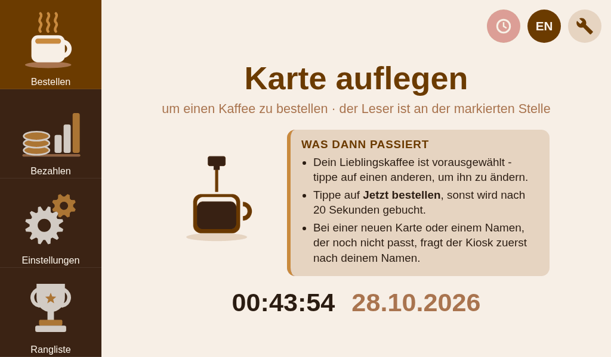

Außer der Rangliste brauchen alle Bereiche eine Karte. Wer eine Karte auflegt, ist angemeldet,
bis er fertig ist oder nach 20 Sekunden ohne Eingabe automatisch abgemeldet wird. Ein Tipp auf
einen Bereich in der Leiste meldet ebenfalls ab. **Bezahlen**, **Einstellungen** und
die **Rangliste** springen nach 30 Sekunden ohne Tipp von selbst zurück auf **Bestellen** – so
findet der Nächste den Kiosk immer bestellbereit vor.

### Bestellen

Der Startbildschirm. Er erklärt, was nach dem Auflegen passiert, und zeigt die Uhrzeit.

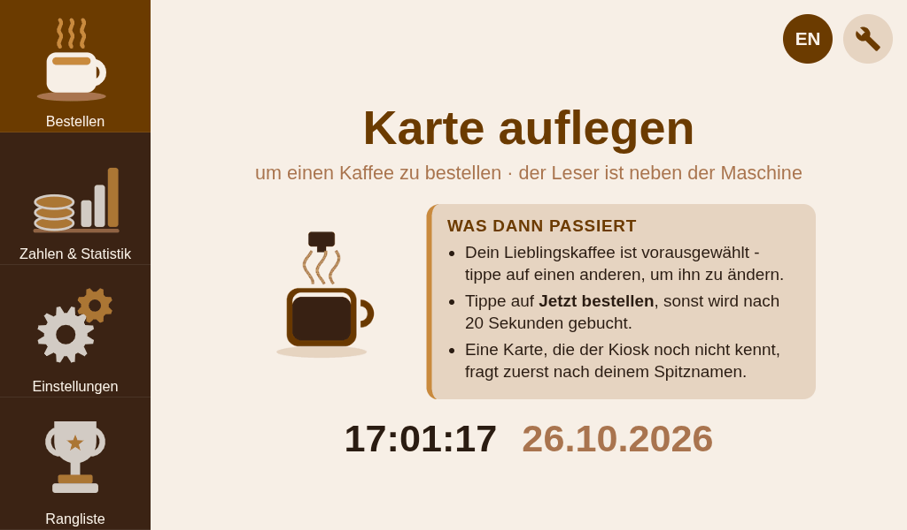

Nach dem Auflegen begrüßt dich der Kiosk mit Namen. Dein Lieblingskaffee ist vorausgewählt;
tippe einen anderen an, um zu wechseln. **Jetzt bestellen** bucht sofort, **Abbrechen** bricht
ab, und ohne Eingabe wird nach 20 Sekunden automatisch gebucht. Wählst du eine andere Sorte,
entfällt die automatische Buchung – dann bestätigst du selbst. Die Medaillen neben dem Namen
zeigen einen Platz unter den Top 3 – insgesamt und in diesem Monat. Wer aus dem Vormonat noch
etwas schuldet, bekommt hier eine Erinnerung.

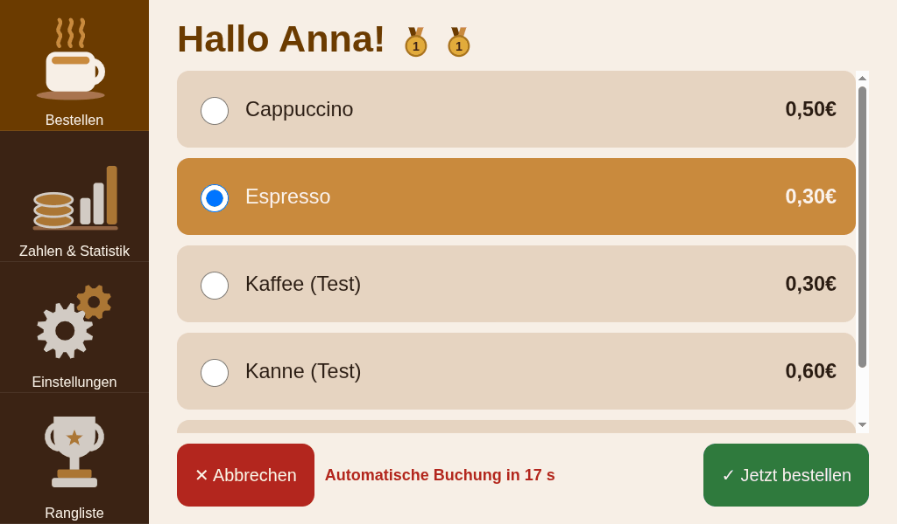

Danach ein Dankeschön – je nachdem, wie viele Tassen es heute schon waren, mit einer anderen
Animation.

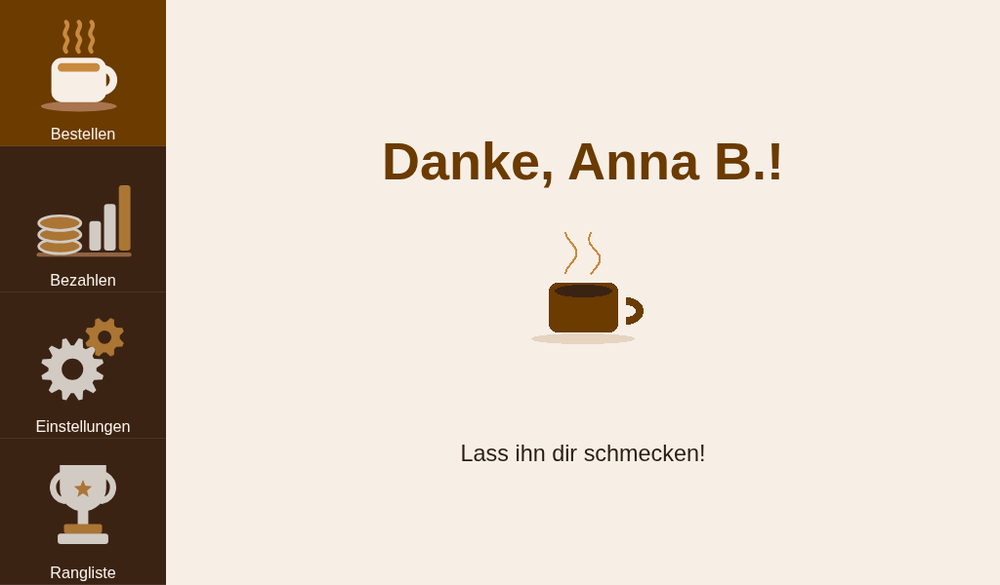

### Bezahlen

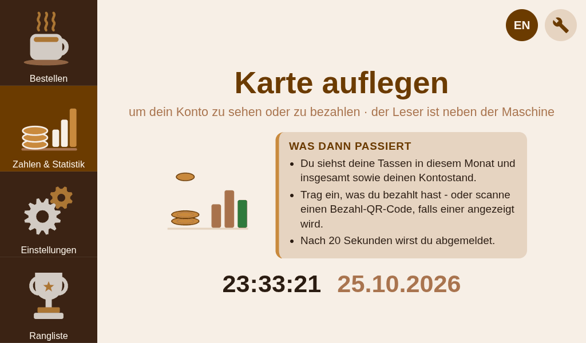

Hier zahlst du ein. Zur Information zeigt der Bildschirm dazu deine Tassen insgesamt (**CCT**)
und in diesem Monat (**CCM**) und deinen **Kontostand**. Ist er negativ, steht der offene Betrag schon im Feld – trag ein, was du
bezahlt hast, wähle die Zahlungsart und tippe **Bezahlen**. Sind Zahlungsmethoden mit Link
eingerichtet, kannst du den offenen Betrag auch direkt per QR-Code mit dem Handy bezahlen.

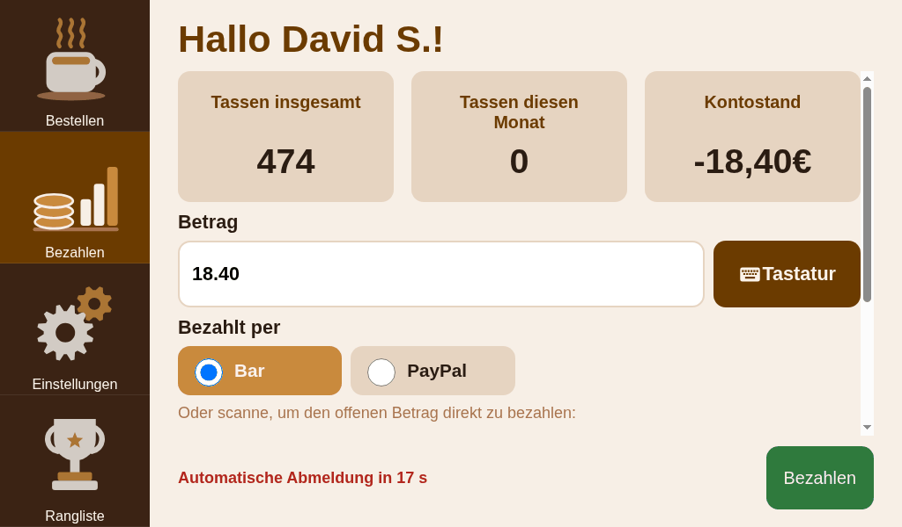

### Einstellungen

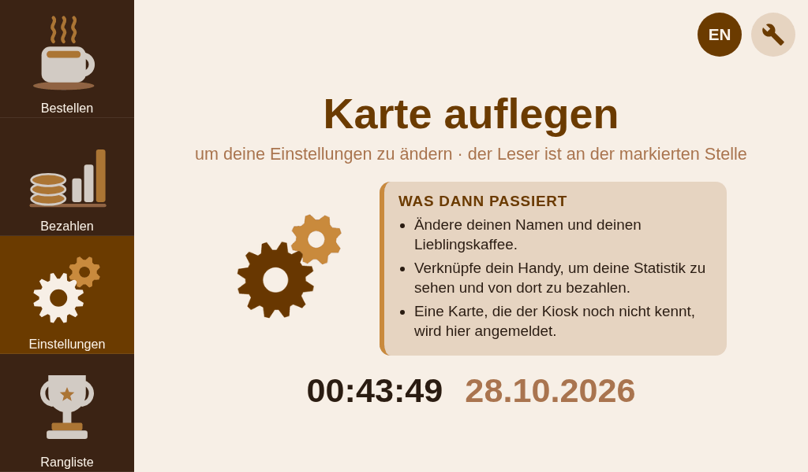

Hier änderst du **Namen** und **Lieblingskaffee** und tippst **Speichern**. Getippt wird
direkt oder über **Tastatur** mit der Bildschirmtastatur – sie hat auch Umlaute, ß, Bindestrich
und Punkt.

Der Name ist **Vorname und erster Buchstabe des Nachnamens**, z. B. *Anna B.*, oder ein
**Kürzel** aus zwei bis vier Großbuchstaben, z. B. *AB* – so wissen alle, wer in der Rangliste und
am Pranger steht. Großschreibung und Punkt ergänzt der Kiosk selbst (*anna b* wird *Anna B.*). Abgelehnt werden Platzhalter (*Test*, *Name*, *Kaffee* …),
Tastatur-Gehämmer (*Asdf*) und ein Name, den schon jemand trägt – dann hilft ein zweiter
Buchstabe: *Anna Be.* Wessen Name nicht passt – auch wer noch seine Kartennummer als Namen hat –,
wird beim nächsten Kaffee **zuerst nach dem Namen gefragt** (*Wer bist du?*) und bestellt erst
danach; nach dem Speichern geht es direkt zur Bestellung. Im Feld steht dann schon, was sich aus
dem alten Namen machen lässt – aus *Anna* wird *Anna*␣, es fehlt nur der Buchstabe. Fehlt einem
Namen nur die Form (*Anna B* ohne Punkt), korrigiert der Kiosk ihn ohne Nachfrage.

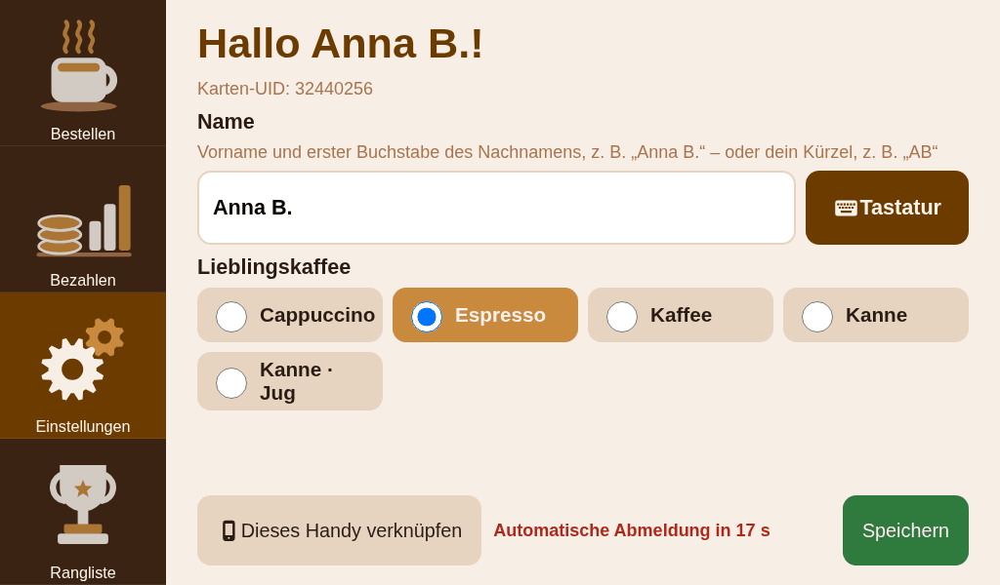

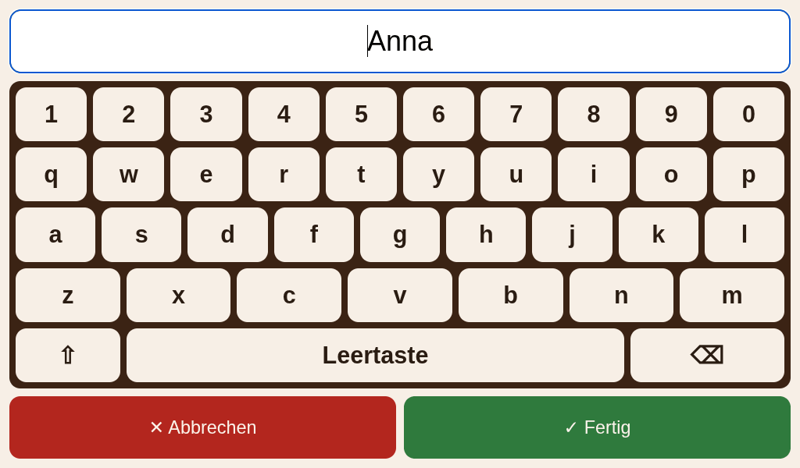

Eine Karte, die der Kiosk noch nicht kennt, landet automatisch hier: Mit dem Speichern ist das
neue Mitglied angelegt.

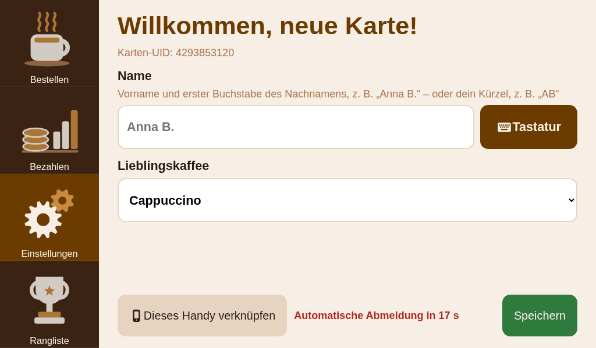

**Dieses Handy verknüpfen** zeigt einen QR-Code, mit dem du dein Handy mit deinem Konto
verbindest (siehe [Handy-Portal](#5-das-handy-portal)). Der Code gilt fünf Minuten und nur
einmal. Mit Access Point steht daneben der QR-Code zum WLAN – das Handy muss zuerst dort
verbunden sein.

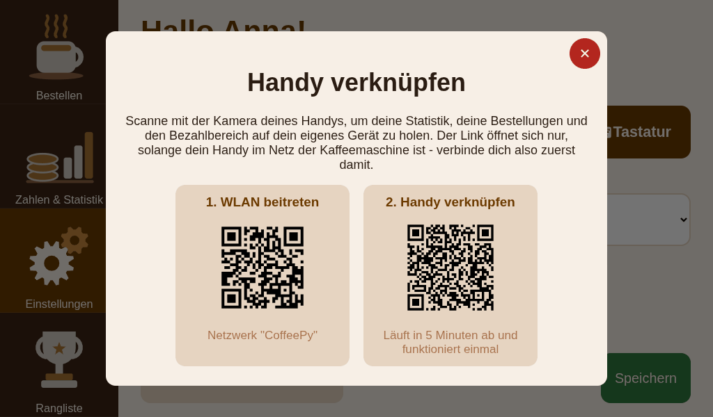

### Rangliste

Braucht keine Karte. Oben drei Reiter, jeder mit eigener Retro-Animation; die Namen stehen im
Balken darunter. Gezählt werden Tassen – eine Kanne zählt zwei.

- **Gesamt** – das Siegerpodest: die Top 3 seit Beginn, der Erste in der Mitte.

  

- **Dieser Monat** – der Monat läuft noch: Die aktuellen Top 3 stehen bereit, während ein
  Vierter Anlauf nimmt, über einen Drehstuhl zur Kaffeemaschine springt und auf die Noten der
  Jury wartet.

  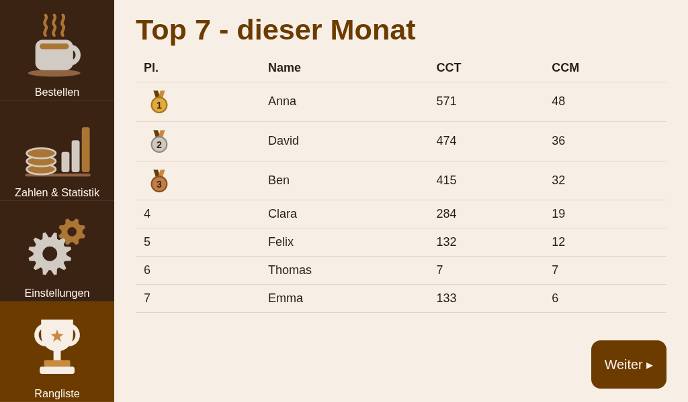

- **Pranger** – alle, die bis zum Vormonat noch etwas schulden, beim Gang der Schande; ihre
  Namen und Beträge laufen im Balken darunter durch. Haben alle bezahlt, steht **NO SHAME** im
  Banner, und der Henker steht ohne Arbeit auf dem leeren Schafott.

  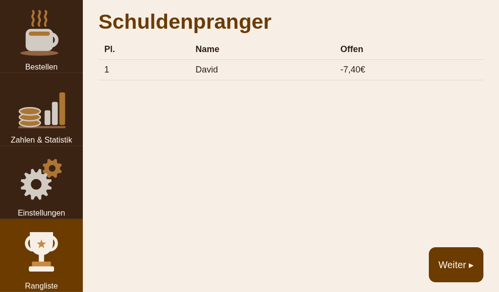

Die Rangliste öffnet immer mit ihrem ersten Reiter.

**Ob es Rangliste und Pranger gibt, entscheidet der Admin** (Dashboard → **System** →
*Rangliste und Pranger*): Ist eines aus, fehlt sein Reiter; ist beides aus, fehlt der Knopf
**Rangliste** ganz – und die Medaille nach einer Bestellung auch. Ein neu eingerichtetes Gerät
startet mit beidem aus; siehe [Datenschutz und Arbeitsplatz](#datenschutz-und-arbeitsplatz).

### Admin-Zugang

Der runde Schraubenschlüssel oben rechts ist für die, die das Gerät betreuen: Er zeigt zwei
QR-Codes, einen, um dem WLAN des Geräts beizutreten, und einen, der das Dashboard öffnet – der
Touchscreen selbst hat ja keine Tastatur. Mitglieder brauchen ihn nicht; ihr Handy verknüpfen
sie unter **Einstellungen**.

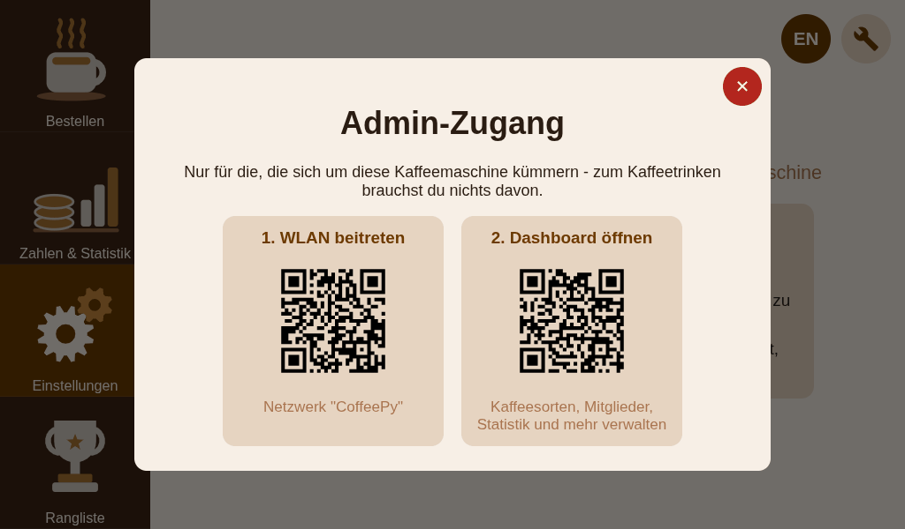

### „Wir sind gleich wieder da“

Während einer Installation, eines Updates oder einer Wiederherstellung – und wenn die App kurz
nicht antwortet – zeigt der Kiosk diesen Bildschirm und nimmt keine Eingaben an. Ist die Arbeit
erledigt, lädt er sich von selbst neu; dasselbe gilt für eine Fehlerseite.

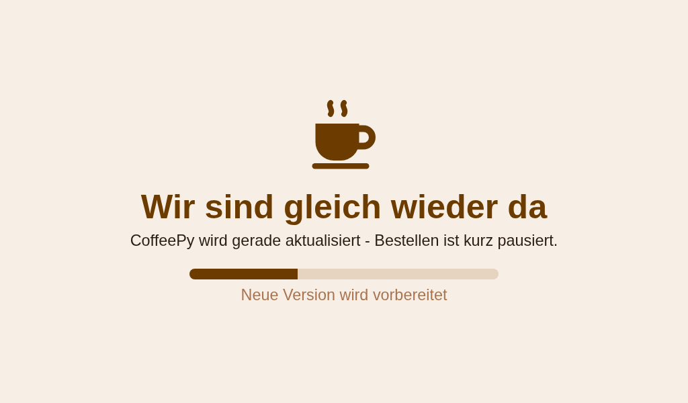

---

## 5. Das Handy-Portal

Jedes Mitglied kann sein Handy verknüpfen: am Kiosk unter **Einstellungen** die Karte
auflegen, **Dieses Handy verknüpfen** tippen und den QR-Code mit der Kamera scannen. Das Handy
bleibt danach sechs Monate angemeldet (bei jeder Nutzung verlängert). Die Sprache stellst du
oben rechts um; sie gilt nur für dieses Handy.

**Start** zeigt Tassen, Kontostand und die letzten Bestellungen und Zahlungen. Unten auf der
Seite findest du das Gerätezertifikat.

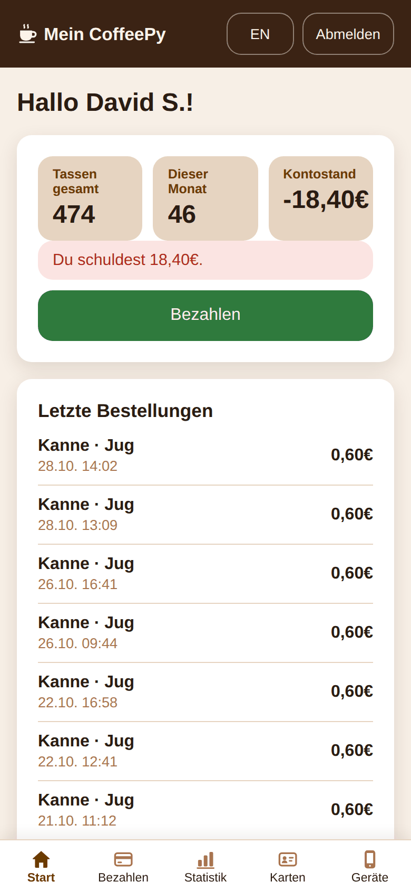

**Bezahlen** öffnet deine Bezahl-App mit dem offenen Betrag, oder du trägst eine Zahlung ein,
die du schon gemacht hast.

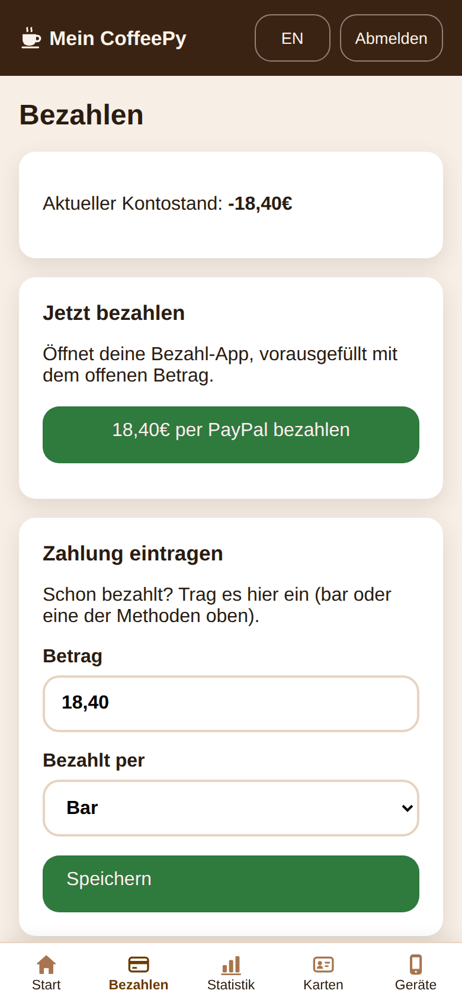

**Statistik** vergleicht dich mit den anderen: Tassen pro Monat, Uhrzeit, Wochentag und Sorte.

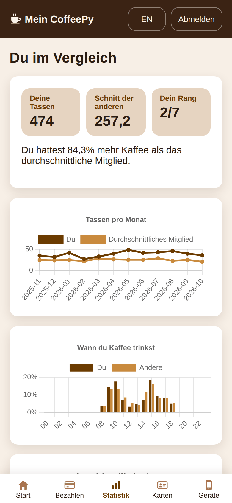

**Karten** zeigt deine Karten; über *Neue Karte hinzufügen* verknüpfst du eine Ersatzkarte,
indem du sie an den Kiosk hältst. **Geräte** listet deine verknüpften Handys – dort meldest du
ein verlorenes Gerät ab.

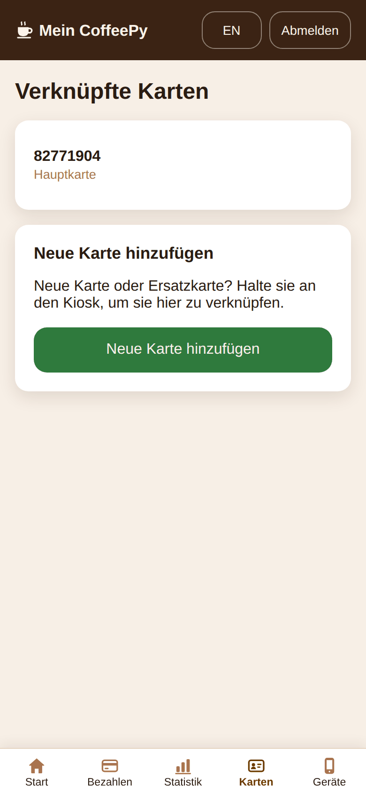

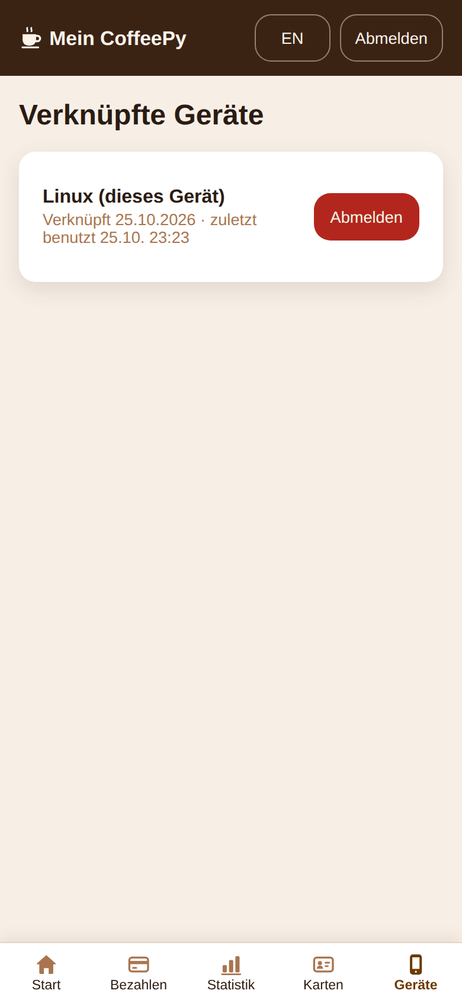

Ein Link, der abgelaufen ist oder schon benutzt wurde, führt hierher – dann einfach am Kiosk
einen neuen erzeugen.

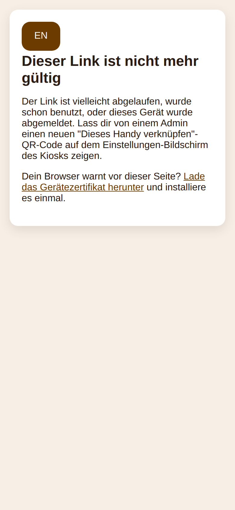

### Wie das Verknüpfen funktioniert – und warum es unbedenklich ist

Das Portal kommt ohne Passwörter aus. Stattdessen übergibt der Kiosk dem Handy einen
**Einmal-Link**:

1. **Nur mit deiner Karte, nur am Gerät.** Den QR-Code unter **Dieses Handy verknüpfen** gibt
   es nur, solange du am Kiosk mit deiner Karte angemeldet bist. Den Kiosk selbst erreicht man
   nur über den Touchscreen, nicht über das Netz – niemand kann von seinem Handy oder PC aus
   einen Link für jemand anderen anfordern.
2. **Ein Zufallswert, kein Passwort.** Der Link enthält 256 Bit aus einem kryptografischen
   Zufallsgenerator (43 Zeichen). Er lässt sich nicht erraten oder ausrechnen, auch nicht mit
   beliebig vielen Versuchen in den fünf Minuten, die er gilt.
3. **Fünf Minuten, einmal.** Der Link verfällt nach fünf Minuten und wird gelöscht, sobald er
   geöffnet wird – ein zweiter Scan landet bei *Link ungültig*. Ein neuer Link ersetzt einen
   älteren, den das Mitglied noch nicht benutzt hat.
4. **Das Handy bekommt eine eigene Anmeldung.** Das Öffnen des Links startet auf diesem Handy
   eine neue Sitzung: ein Cookie, das nur über HTTPS übertragen wird (verschlüsselt, geprüft
   gegen das Gerätezertifikat) und das die Scripte der Seite nicht lesen können. Es gilt sechs
   Monate und verlängert sich bei jeder Nutzung; der Link selbst ist ab da wertlos.
5. **Alles lässt sich zurücknehmen.** Jedes verknüpfte Handy steht im Portal unter **Geräte**
   und lässt sich dort abmelden; ein Admin macht das mit **Geräte abmelden** für alle Handys
   eines Mitglieds, und ein als ausgeschieden markiertes Mitglied ist überall abgemeldet. Das
   Ausgeben des Links, jede Anmeldung und jeder Fehlversuch stehen im
   [Protokoll](#weitere-systemseiten).

**Was ein Handy dort darf** – und damit, was ein Fremder mit dem Handy eines anderen könnte:
Tassen, Kontostand und Buchungen dieses Mitglieds sehen, sie mit den Summen der anderen
vergleichen, eine Zahlung eintragen, die man *nach eigener Angabe* gemacht hat, und das
Hinzufügen einer Karte starten – die dann trotzdem an den Kiosk gehalten werden muss. Geld
fließt dabei keines: Eine im Portal eingetragene Zahlung ist ein Vermerk wie am Kiosk, sie
erscheint unter **Buchungen** und im Protokoll, und ein Admin kann sie korrigieren. Dashboard
und Kiosk sind mit einer Portal-Anmeldung nicht erreichbar.

**Das Einzige, worauf man achten sollte:** Wer den QR-Code in diesen fünf Minuten abfotografiert
und als Erster öffnet, bekommt statt des Mitglieds dessen Portal. Das Mitglied merkt es sofort
(sein eigener Scan meldet *Link ungültig*), das Handy steht unter **Geräte**, und ein Tipp
meldet es wieder ab. Also: selbst scannen, gleich, und das Fenster danach schließen.

---

## 6. Das Dashboard

Das Dashboard erreichst du unter `https://<Adresse>/dashboard/`. Auf PC und Tablet stehen die
Seiten in der Leiste links; auf dem Handy sind die alltäglichen unten als Reiter, alles andere
unter **Mehr**.

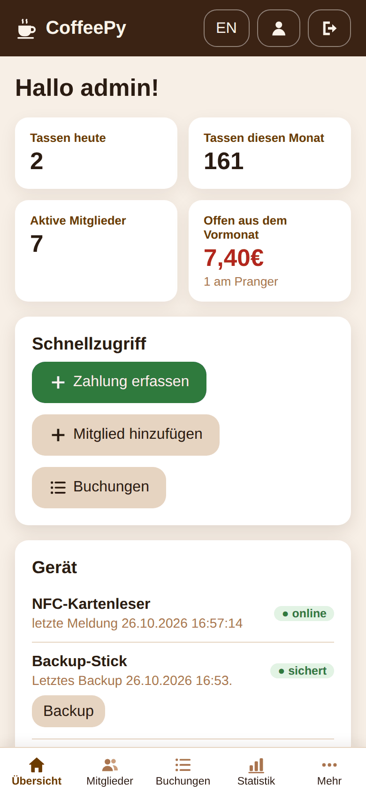

Es gibt zwei Rollen (siehe [Dashboard-Benutzer](#dashboard-benutzer)): **Betreuer** kümmern sich
um Mitglieder, Buchungen, Kaffeesorten und Zahlungsmethoden; **Admins** dürfen zusätzlich alles
unter **System** – Benutzer, Anmelderegeln, Backups, Updates, Zertifikat, Protokoll und so
weiter. Das Admin-Konto aus der Einrichtung ist ein Admin. Eine andere Verwaltungsoberfläche
gibt es nicht.

Die **Übersicht** zeigt die wichtigsten Zahlen, Knöpfe zum Erfassen einer Zahlung oder eines
Mitglieds und die Karte **Gerät**: Ist der Kartenleser online, laufen die Backups, ist das
Uhrenmodul (RTC) in Ordnung, und unter welcher Adresse erreichen Handys das Gerät. Was hier rot
ist, braucht Aufmerksamkeit – dasselbe blinkt auch am Kiosk rot.

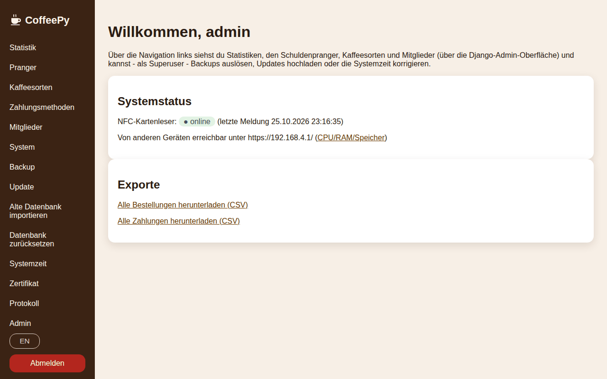

### Statistik und Pranger

**Statistik**: Tassen und Umsatz der letzten 12 Monate, Verteilung der Sorten, Tassen nach
Uhrzeit und Wochentag (die Titel nennen die meistbesuchte Zeit), Preisentwicklung und
Zahlungen nach Methode. Gezählt werden Bezüge – eine Kanne zählt zwei Tassen.

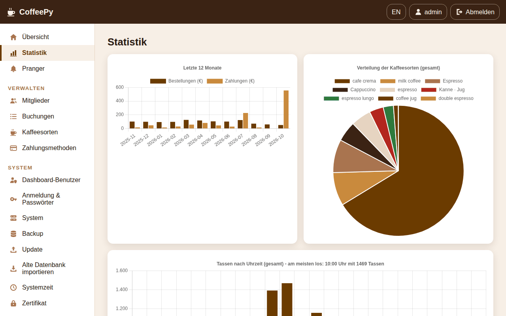

**Pranger**: alle Mitglieder mit negativem Kontostand, gerechnet bis zum Vormonat – dieselbe
Liste wie am Kiosk.

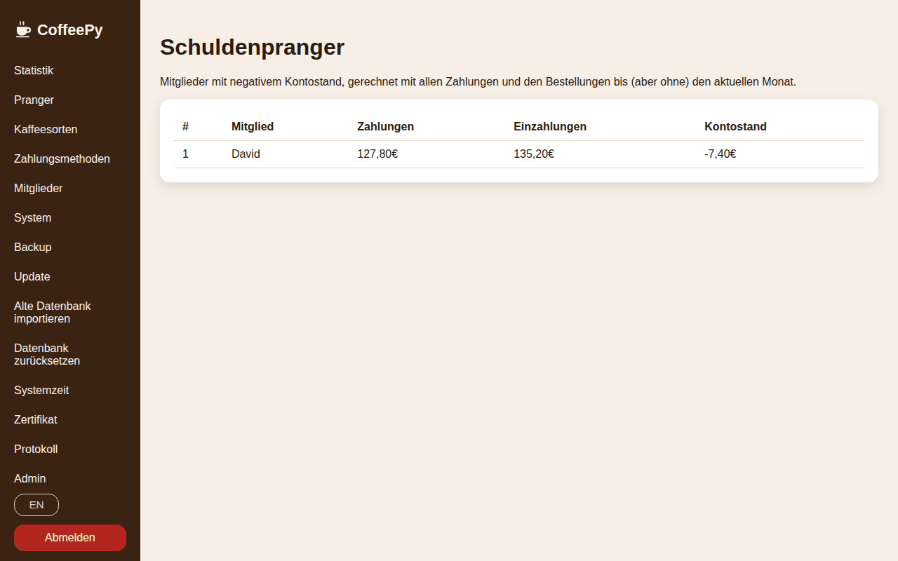

### Mitglieder

Die Liste aller Mitglieder mit ihren Karten und dem Tag ihres **letzten Kaffees** – daran
erkennst du auch bei einer Karte ohne Namen, ob noch jemand sie benutzt oder ob ihr Besitzer
längst gegangen ist (dann *Als ausgeschieden markieren*). Pro Mitglied:

- **Bearbeiten**: Name, UID, Lieblingskaffee. Für den Namen gelten dieselben Regeln wie am Kiosk
  (siehe [Einstellungen](#einstellungen)).
- *Neuer Name beim nächsten Kaffee*: Dieser Name passt nicht zu den Regeln – der Kiosk fragt
  das Mitglied beim nächsten Kaffee nach einem neuen.
- **Karte hinzufügen**: Die nächste Karte, die am Kiosk aufgelegt wird, gehört danach zu diesem
  Mitglied – so bekommt jemand eine Ersatzkarte, ohne dass ein zweites Konto entsteht.
- **Geräte abmelden**: meldet alle verknüpften Handys ab.
- **Als ausgeschieden markieren**: bucht den Kontostand aus und sperrt die Karten; lässt sich
  mit *Reaktivieren* rückgängig machen.

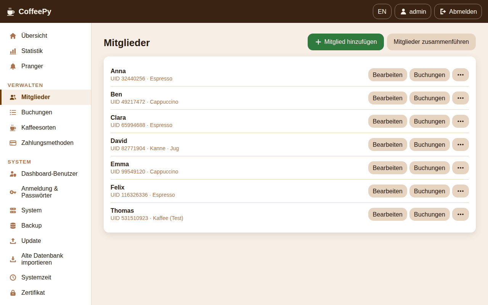

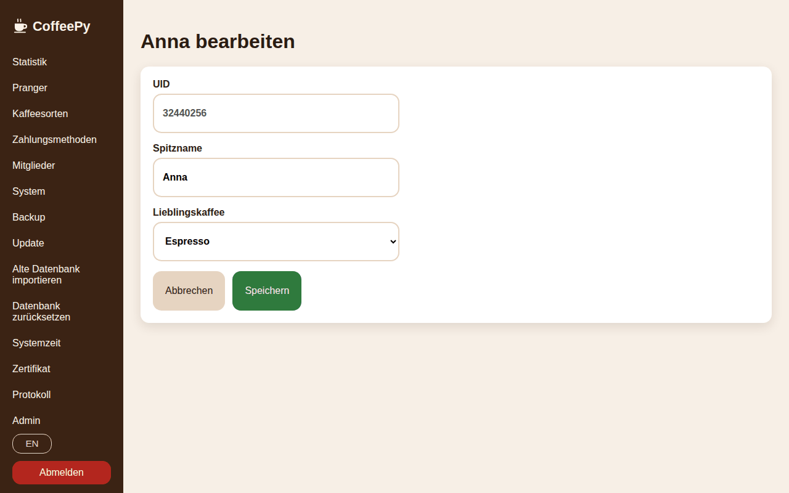

**Mitglieder zusammenführen** hilft, wenn doch zwei Konten entstanden sind: Alle Bestellungen,
Zahlungen und Karten wandern auf das Konto, das du behältst, das andere wird gelöscht.

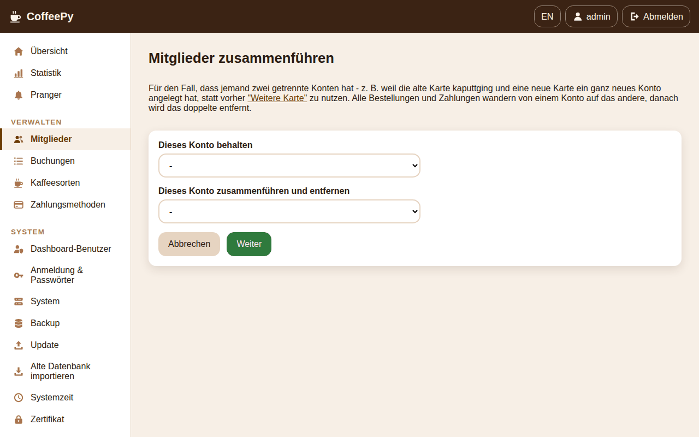

Unter **Namen** (nur für Admins) trägst du **gesperrte Vornamen** (oder Kürzel) ein, einen pro Zeile –
zusätzlich zu den üblichen Platzhaltern, die immer abgelehnt werden. Gedacht für das, worauf
nur jemand aus dem Team kommt (*Chef*, der Name der Kaffeemaschine …). Wer einen davon schon
trägt, wird beim nächsten Kaffee nach einem neuen Namen gefragt.

### Buchungen

Jeder gebuchte Kaffee und jede Zahlung, die neuesten zuerst, filterbar nach Mitglied (mit
dessen Kontostand). Hier korrigierst du eine falsche Buchung (**Bearbeiten**, **Löschen**) und
erfasst eine Zahlung, die nicht über den Kiosk lief – **Zahlung erfassen**, etwa Bargeld in
der Kasse. Jede Änderung landet im Protokoll.

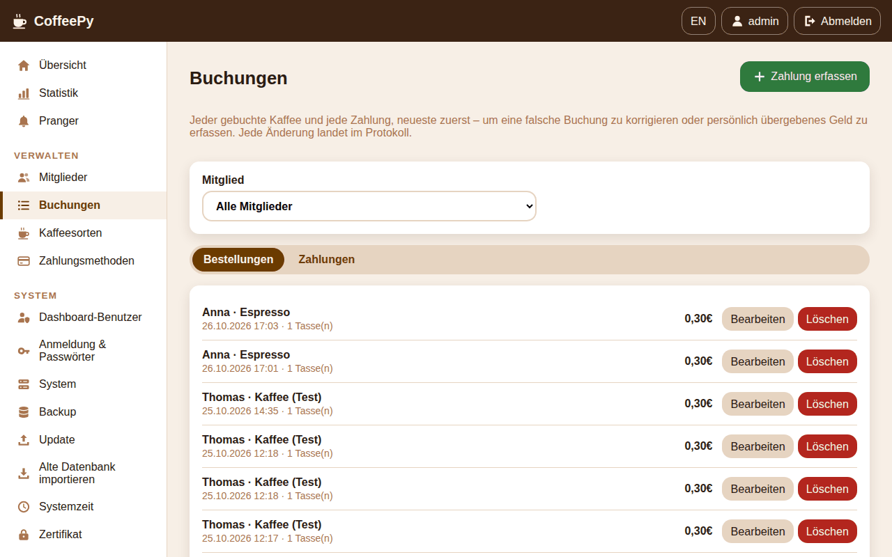

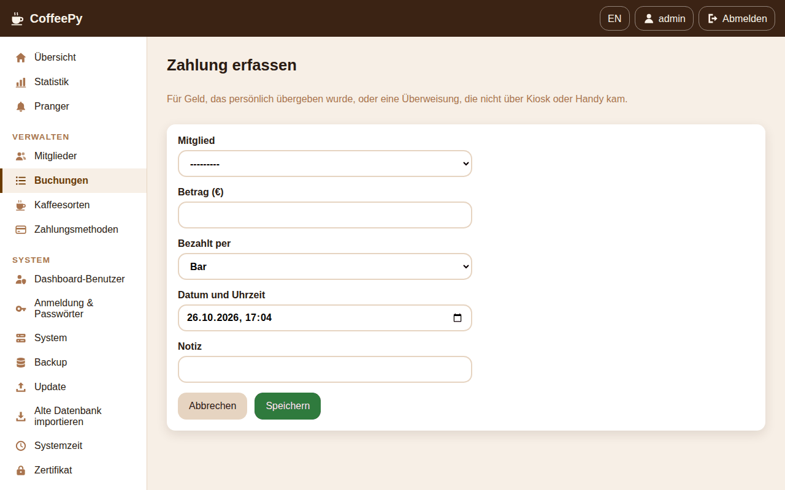

### Kaffeesorten und Zahlungsmethoden

**Kaffeesorten**: die Sorten, die am Kiosk zur Auswahl stehen – Name, Preis und Bezüge.

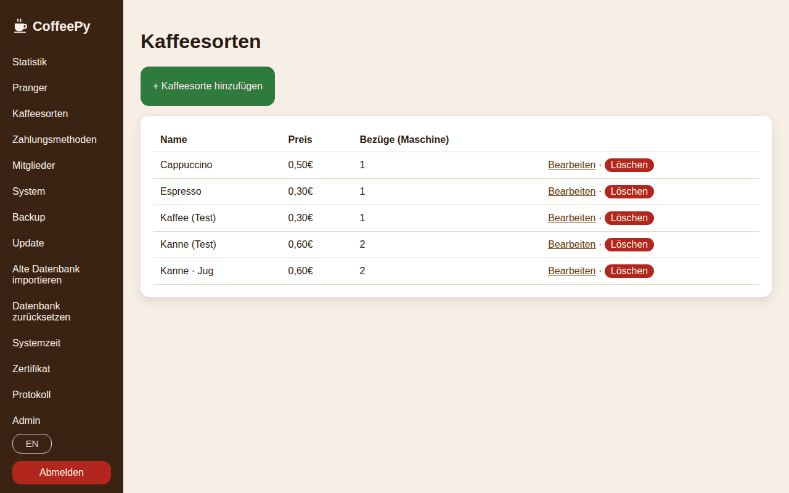

**Zahlungsmethoden**: Für PayPal reicht der paypal.me-Name, für PayPal Pool die URL des
Pools, für WERO die Telefonnummer; *Eigener Link* nimmt jede Adresse, optional mit `{amount}`
für den offenen Betrag. Daraus entstehen die Bezahl-Links und QR-Codes an Kiosk und Handy.

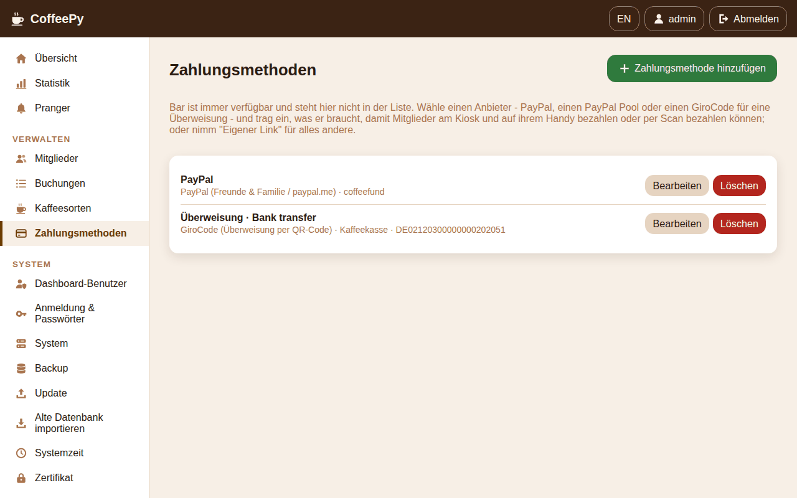

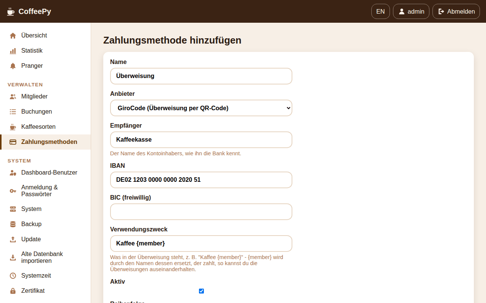

### Mein Konto

Dein Name oben rechts: deine Rolle, deine letzte Anmeldung und **Passwort ändern**. Dein
eigenes Passwort änderst du nur hier, nie in der Benutzerliste.

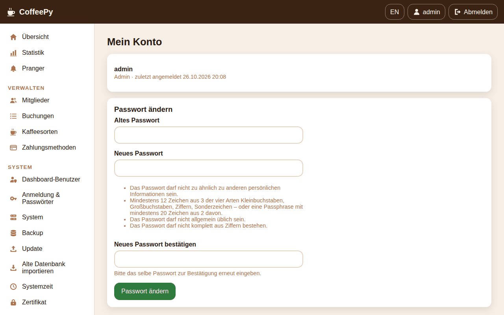

### Dashboard-Benutzer

Wer sich am Dashboard anmelden darf – nur für Admins. **Benutzer anlegen** fragt nach
Benutzername, Rolle (**Admin** oder **Betreuer**) und einem ersten Passwort; mit *Muss bei der
ersten Anmeldung ein neues Passwort setzen* gibst du es als Einmal-Passwort weiter. Pro
Benutzer: **Bearbeiten**, **Passwort setzen** (für ein vergessenes), **Löschen**. Wer nach zu
vielen Fehlversuchen gesperrt ist, ist als *gesperrt* markiert.

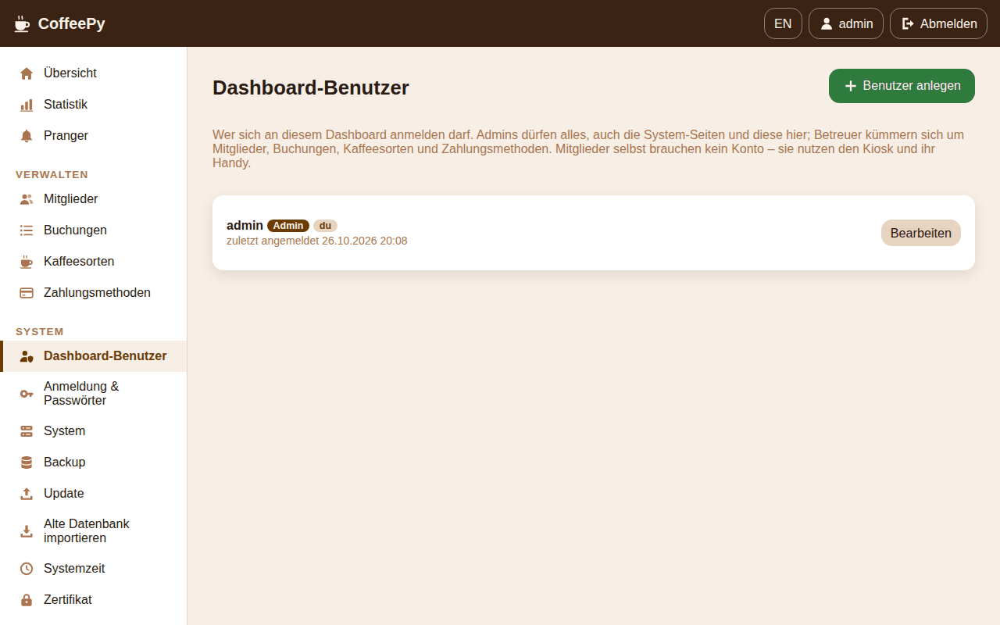

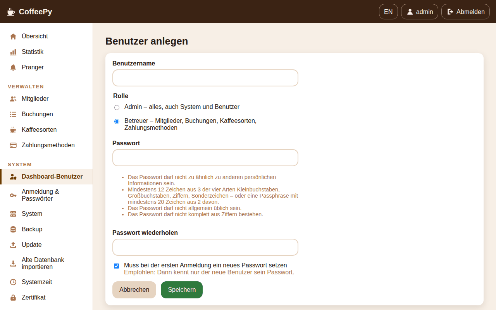

### Anmeldung & Passwörter

Die Regeln für die Anmeldung. Die Vorgaben folgen der Empfehlung des BSI und lassen sich nur
in sinnvollen Grenzen einstellen:

| Regel | Vorgabe | Möglich |
|---|---|---|
| Mindestlänge | 12 Zeichen | 8–64 |
| Zeichenarten (Klein-, Großbuchstaben, Ziffern, Sonderzeichen) | 3 | 1–4 |
| … oder eine lange Passphrase ab | 20 Zeichen mit 2 Arten | aus, oder bis 128 |
| Sperre nach Fehlversuchen | 5 | 3–20 |
| Gesperrt für | 15 Minuten | 1–1440 |
| Abmelden bei Inaktivität nach | 30 Minuten | 5–480 |

Passwörter sind höchstens 128 Zeichen lang. Werden die Regeln **strenger**, wird niemand
ausgesperrt: Wessen Passwort sie nicht mehr erfüllt, der wird bei der nächsten Anmeldung nach
einem neuen gefragt.


### System

**System** zeigt CPU, Arbeitsspeicher und Speicherplatz des Geräts.


**Rangliste und Pranger**: was der Kiosk allen an der Maschine zeigt – die Rangliste (wer am
meisten trinkt, gesamt und im Monat) und den Pranger (wer Geld schuldet), je mit einem Haken.
Der Kiosk folgt mit seiner nächsten Abfrage. Die Seite **Pranger** im Dashboard, für den, der
das Geld einsammelt, bleibt davon unberührt. Siehe
[Datenschutz und Arbeitsplatz](#datenschutz-und-arbeitsplatz).

Steht oben unter der Adresse ein Hinweis, die Adresse sei *nur geschätzt*, ist `PUBLIC_HOST` in
`.env` leer und die Adresse vermutlich die des App-Containers – die QR-Codes führen dann ins
Leere. Das Provisioning-Tool und der Installer setzen sie; von Hand: `PUBLIC_HOST=` mit der
Adresse des Geräts.

**Nachtruhe**: Mit *Kiosk nachts ausschalten* schaltet der Kiosk um *Aus ab* (z. B. 20:00) den
Bildschirm dunkel und kommt um *Wieder an ab* (z. B. 05:30) von selbst wieder. Für *Samstag und
Sonntag* wählst du *Wie unter der Woche*, *Den ganzen Tag aus* oder *Eigene Zeiten*
(*Wochenende: aus ab* / *wieder an ab*). Eine Nacht gehört zu dem Tag, an dem sie beginnt: Die
Freitagnacht läuft bis Samstagmorgen nach den Zeiten unter der Woche, und nach einem ganz
ausgeschalteten Sonntag kommt der Kiosk am Montag zu *Wieder an ab*. In der Nacht werden Karten an der
Maschine **nicht gebucht** – auch nicht nachträglich am Morgen. Das Handy-Portal, die Backups
und das Dashboard laufen weiter. Eine Änderung greift innerhalb einer Minute; sie steht als
*night.update* im **Protokoll**.

**Systemzeit**: nur nötig, wenn das Uhrenmodul fehlt oder falsch geht. Die neue Zeit wird
innerhalb von zehn Minuten auch in das Uhrenmodul geschrieben.

Ohne Netz gibt es niemanden, der die Uhr richtig stellt – deshalb passt das Gerät selbst
auf, dass sie nicht **zurück** geht: Springt sie zurück, oder steht sie vor den neuesten
Einträgen im Protokoll (jede Buchung schreibt einen), stellt es sie wieder vor und zeigt das
rote Uhr-Zeichen am Kiosk. Auf der Übersicht steht dann, von wann auf wann. Prüfe die Zeit
und stelle sie hier, oder bestätige sie mit **Die Uhrzeit stimmt** – dann verschwindet das
Zeichen. Zurückgestellt wird sie nie: Eine Uhr, die vorgeht, lässt sich von einer richtigen
nicht unterscheiden. Hat das Gerät Internet, stellt es die Uhr ohnehin selbst, und diese
Prüfung hält sich heraus.


#### Backup

Alles rund um den Backup-Stick (wie er funktioniert, steht unter [Backups](#backups)):

- **Backup-Stick dieses Geräts** – Platz, ob die Backups verschlüsselt sind, **Jetzt sichern**,
  **Sicher auswerfen** und die Backups darauf, jeweils mit **Herunterladen** und
  **Wiederherstellen**. *geprüft* heißt, die Prüfsumme stimmt, *beschädigt*, dass nicht.
- **USB-Sticks** – ein Stick, der noch nicht eingerichtet ist: **Als Backup-Stick einrichten**.
  Ein früherer Stick dieses Geräts oder der eines anderen CoffeePy lässt sich lesen und mit
  **Für dieses Gerät nutzen** übernehmen.
- **Wann gesichert und was aufbewahrt wird** – wie oft (alle 15 Minuten bis einmal am Tag) und
  wie viele Backups bleiben: die neuesten, dann eines pro Tag, Woche und Monat.
- **Backup wiederherstellen** – vom Stick oder **Aus einer Datei wiederherstellen**.
- **Backup herunterladen** – das ganze Gerät, wie es gerade ist, als Datei, auch ohne Stick.


Beim Wiederherstellen wählst du, **was**: die Daten (Mitglieder, Buchungen, Kaffeesorten,
Dashboard-Anmeldungen), die Zertifikate samt Geräte-CA (Handys vertrauen dem Gerät weiter), die
Geräte-Identität (sein Backup-Stick wird der dieses Geräts) und die Einstellungen (Sprache,
Adresse, Zeitzone, Aufbewahrung des Protokolls). Zur Bestätigung tippst du `DELETE`. Bevor sich
etwas ändert, wird der aktuelle Stand auf den Stick gesichert; schlägt die Wiederherstellung
fehl, bleibt alles, wie es war. Ein verschlüsseltes Backup braucht die Passphrase.


#### Update

Ein Update-Paket hochladen und verfolgen, wie es eingespielt wird (siehe [Updates](#updates)).
**Zurück zu …** kehrt zur Version vor dem letzten Update zurück. **Versionen** listet genau, was
auf dem Gerät läuft: die CoffeePy-Version und ihren Commit, Python, Django, die Datenbank, das
Betriebssystem, Docker und jeden Container mit der ID seines Images – **Alle kopieren** legt die
ganze Liste in die Zwischenablage, fertig für eine Fehlermeldung. Die CoffeePy-Version allein
steht auch unten in der Navigation des Dashboards, unten im Handy-Portal und am Kiosk unter den
QR-Codes für den Admin-Bereich (Schraubenschlüssel).


#### Zertifikat

Zeigt, welches Zertifikat gerade verwendet wird. Du kannst ein **eigenes Zertifikat** (PEM,
mit Kette, und den unverschlüsselten privaten Schlüssel) hochladen; es ist nach wenigen
Sekunden aktiv. CoffeePy prüft, dass Schlüssel und Zertifikat zusammenpassen, und warnt, wenn
es nicht für die Adressen des Geräts gilt. Ein Knopf führt zurück zum selbstsignierten
Zertifikat. Der Kiosk auf dem Gerät nutzt immer das eigene Zertifikat – ein fehlerhafter
Upload sperrt ihn also nie aus.


#### Weitere Systemseiten

**Alte Datenbank importieren**: übernimmt die Daten aus einem alten CoffeePy (V1) – eine
`coffee.db` oder eines ihrer Backups. Der Import läuft im Hintergrund weiter, auch wenn du die
Seite schließt.


**Protokoll**: alles, was am Gerät passiert ist – Anmeldungen und Fehlversuche, jede Änderung
im Dashboard, Buchungen und Einstellungen an Kiosk und Portal, Backups, Wiederherstellungen,
Updates, der Backup-Stick und das Uhrenmodul. Pro Eintrag: wann, wer, von wo, was und ob es
geklappt hat. **Suche** und die Filter grenzen es ein, **Export (CSV)** lädt das Angezeigte
herunter. Einträge werden nach der Aufbewahrungsfrist gelöscht (standardmäßig 90 Tage, siehe
[Provisioning-Tool](#das-provisioning-tool)).


**Datenbank zurücksetzen** löscht **alle** Kaffeedaten (Mitglieder, Karten, Bestellungen,
Zahlungen, Sorten, Zahlungsmethoden, Protokoll). Die Anmeldungen am Dashboard bleiben. Zur
Bestätigung musst du `DELETE` eintippen – vorher ein Backup machen!


---

## 7. Betrieb und Wartung

### Einstellungen ändern

Lass einfach das [Provisioning-Tool](#das-provisioning-tool) erneut laufen: Es liest die
bestehende Konfiguration, du änderst, was du willst, und es spielt die Änderung ein – der Kiosk
zeigt währenddessen „Wir sind gleich wieder da“. Daten, Datenbankpasswort und Zertifikat
bleiben erhalten.

### Backups

Das Gerät sichert sich auf **einen USB-Stick**, den du dafür einrichtest:

1. Stick einstecken und im Dashboard **Backup** öffnen.
2. **Als Backup-Stick einrichten** – nach einer Rückfrage wird der Stick **gelöscht**,
   formatiert und als Stick dieses Geräts markiert. Die Backups beginnen sofort.
3. Ab dann sichert das Gerät im eingestellten Abstand (standardmäßig stündlich) und dünnt aus:
   die neuesten 48, dann 14 Tage lang eines pro Tag, 8 Wochen lang eines pro Woche, 12 Monate
   lang eines pro Monat.

Ein Backup enthält das ganze Gerät: die Daten, die Geräte-CA und Zertifikate und seine
Einstellungen – so kann ein Ersatzgerät vollständig übernehmen. Jedes Backup wird nach dem
Schreiben zurückgelesen und geprüft. Mit einer Passphrase aus dem
[Provisioning-Tool](#das-provisioning-tool) wird es verschlüsselt (AES-256); ohne kann es jeder
lesen, der den Stick nimmt – eine bewusste Entscheidung, wenn der Stick im Gehäuse sitzt.

- **Stick abgezogen?** Übersicht und Kiosk zeigen, dass keine Backups laufen. Steckst du den
  **gleichen** Stick wieder ein, geht alles weiter wie gewohnt.
- **Neuer Stick?** Er muss eingerichtet werden wie der erste. Der alte wird dabei vergessen: Das
  Gerät liest ihn noch, schreibt aber nie wieder darauf.
- **Wiederherstellen** steht unter [Backup](#backup). Eine Wiederherstellung ersetzt auch die
  Anmeldungen am Dashboard – eventuell musst du dich danach neu anmelden.

### Updates

Das Gerät braucht für Updates kein Internet. Auf einem PC mit Internet und Docker (oder Podman):

```bash
./scripts/update_builder.sh
```

Der **Update-Paket-Bauer** fragt, was ins Paket kommt – Plattform, die eigenen Dienste des
Geräts, Betriebssystem-Pakete für ein Gerät ohne Internet –, mit welchem Schlüssel signiert wird
(beim ersten Mal legt er einen an) und wohin das Paket kommt. Er baut und signiert es und kann
es auf Wunsch gleich ins Dashboard eines Geräts hochladen und verfolgen, wie es eingespielt wird.


Sonst lädst du das Paket im Dashboard unter **Update** hoch. Das Gerät

1. prüft die **Signatur** und die Prüfsumme jeder Datei, ob das Paket für dieses Gerät gedacht
   ist, ob genug Platz da ist und ob es nicht älter als das Installierte ist (außer *Installation
   einer älteren Version als der installierten erlauben* ist angehakt),
2. sichert die Datenbank und die laufende Version **auf die SD-Karte** (nie auf den Backup-Stick),
3. spielt es ein – der Kiosk zeigt „Wir sind gleich wieder da“ mit Fortschrittsbalken, die
   Update-Seite den Verlauf,
4. prüft, ob die neue Version antwortet. Wenn nicht, kommt die vorige Version **automatisch
   zurück**, samt Daten.

**Zurück zu …** auf der Update-Seite kehrt von Hand zur Version vor dem letzten Update zurück.
Die Daten gehen dabei ebenfalls auf den Stand vor diesem Update zurück.

Für Scripte gibt es `./scripts/build_update_bundle.sh` (seine Optionen stehen am Anfang des
Scripts); ein Update geht auch über das Provisioning-Tool von einem PC aus.

#### Update aus dem GitHub-Release

Jeder Build auf GitHub liegt unter *Releases* bereit – das neueste ist mit *Latest*
markiert. Die Update-Pakete dort sind **unsigniert**, denn der Schlüssel liegt nie bei GitHub.
Für ein Gerät im Einsatz signierst du das Paket selbst, mit deinem eigenen Schlüssel (siehe
[Eigener Signierschlüssel](#eigener-signierschlüssel) – das Gerät muss ihm vertrauen):

1. Aus dem Release `coffeepy-update-<Version>-arm64-unsigned.tar` und
   `sign_update_bundle.sh` herunterladen.
2. Signieren: `bash sign_update_bundle.sh coffeepy-update-<Version>-arm64-unsigned.tar --key
   ~/.config/coffeepy/update-signing.key`. Das Script prüft zuerst jede Datei des Pakets gegen
   seine Prüfsummen, schreibt dann `coffeepy-update-<Version>-arm64.tar` und nennt den
   Fingerabdruck deines Schlüssels – derselbe muss unter **Update › Versionen**
   (*Update-Signatur*) stehen.
3. Das **signierte** Paket im Dashboard unter **Update** hochladen.

Das unsignierte Paket direkt einzuspielen geht nur mit abgeschalteter Prüfung (siehe unten) –
**nur für die Entwicklung** und ein Testgerät.

#### Eigener Signierschlüssel

Ein Gerät spielt nur Updates ein, deren Signatur zu seinem Schlüssel passt – standardmäßig zu
dem, der mit CoffeePy kommt (`install/update-signing.pub`). Baust du Updates selbst, nimm einen
eigenen:

1. **Schlüsselpaar erzeugen** auf dem PC, auf dem du die Updates baust:
   `./scripts/update_signing_key.sh` – der private Schlüssel kommt nach
   `~/.config/coffeepy/update-signing.key` (oder an den Pfad, den du angibst) und **verlässt
   diesen PC nie**; der öffentliche wird nach `install/update-signing.pub` geschrieben.
2. **Den öffentlichen Schlüssel aufs Gerät bringen** – auf einem von zwei Wegen:
   - im [Provisioning-Tool](#das-provisioning-tool) unter **Updates › Eigener Schlüssel** die
     Datei mit dem öffentlichen Schlüssel (`.pub`) wählen. Er landet auf dem Gerät als
     `/etc/coffeepy/update-signing.own.pub`, hat Vorrang vor dem Schlüssel von CoffeePy, und
     **kein Update ersetzt ihn**. **Schlüssel von CoffeePy** entfernt ihn dort wieder.
   - oder aus deinem eigenen Checkout installieren, in dem dein `install/update-signing.pub`
     eingecheckt ist – dann ist er von Anfang an der Schlüssel des Geräts, und jedes Update aus
     diesem Checkout bringt denselben mit.
3. Updates mit diesem Schlüssel bauen: Der Paket-Bauer fragt danach (*Signaturschlüssel*), das
   Script nimmt `--key DATEI`.

Den Fingerabdruck des verwendeten Schlüssels zeigt **Update › Versionen** (*Update-Signatur*).

**Die Prüfung ganz abschalten – nur für die Entwicklung:** im Provisioning-Tool **Updates ›
Keine Prüfung (nur Entwicklung)**, oder
`UPDATE_VERIFY_SIGNATURE=false` in `/opt/coffeepy/.env` auf dem Gerät. Das Gerät spielt dann
jedes Paket ein – signiert, mit einem anderen Schlüssel signiert oder gar nicht signiert
(`build_update_bundle.sh --unsigned`). Prüfsummen, Plattform und Platz werden weiter geprüft.
Mach das nur auf einem Testgerät, an dem sich niemand, dem du nicht traust, als Admin anmelden
kann: Wer ein Update hochladen darf, kann dann alles auf dem Gerät ausführen. Die Update-Seite
im Dashboard warnt, solange die Prüfung aus ist.

### Wenn der Kiosk hängt

Das Gerät sieht jede Minute nach, ob die App antwortet und ob der Browser am Kiosk noch nach
neuen Karten fragt. Hängt etwas, startet es selbst neu, Schritt für Schritt: erst den
Kiosk-Bildschirm, hilft das nicht, die App. Antwortet die App drei Minuten lang nicht, startet
sie gleich neu. Das dauert jeweils eine bis zwei Minuten und steht als
*watchdog.kiosk_restart* / *watchdog.stack_restart* im **Protokoll**.

Während eines Updates, einer Wiederherstellung oder eines Imports und in den ersten Minuten
nach dem Einschalten greift es nicht ein, nachts (**Nachtruhe**) nicht beim Kiosk, und nach drei Neustarts in einer Stunde gibt es auf
(*watchdog.gave_up*): Dann hilft ein Neustart nicht, und es ist Zeit, ins Protokoll zu sehen.
Den Stecker ziehen musst du also nur noch, wenn auch das nichts mehr bewirkt.

### Datenschutz und Arbeitsplatz

CoffeePy verarbeitet personenbezogene Daten von Kolleginnen und Kollegen: Name, Karten-ID, jede
Bestellung mit Uhrzeit, Zahlungen und Kontostand, im Protokoll außerdem, wer wann was im
Dashboard getan hat (mit IP-Adresse, standardmäßig 90 Tage). Im Büro sind Konsum- und
Schuldendaten personenbezogen – in Deutschland gilt dafür die DSGVO, und sobald etwas nach
Verhaltens- oder Leistungsdaten aussieht, kann der **Betriebsrat** mitbestimmen
(§ 87 Abs. 1 Nr. 6 BetrVG: technische Einrichtungen, die dazu *geeignet* sind, Verhalten oder
Leistung zu überwachen – ob das gewollt ist, spielt keine Rolle).

Was dabei hilft, ohne Rechtsberatung zu sein:

- **Rangliste und Pranger bewusst einschalten** (Dashboard → **System**) – ein neues Gerät hat
  beides aus. Gerade der Pranger zeigt allen an der Maschine, wer Schulden hat.
- **Vorher informieren**: wer welche Daten sieht, wozu sie dienen (die Strichliste) und wie
  lange sie bleiben (Art. 13 DSGVO); wo es einen Betriebsrat gibt, ihn vor dem Einschalten von
  Rangliste und Pranger einbeziehen.
- **Kürzel erlauben**: Wer nicht mit Namen in der Rangliste stehen will, nimmt ein Kürzel wie
  „AB“ (siehe [Einstellungen](#einstellungen) am Kiosk).
- **Ausgeschiedene markieren** (Dashboard → **Mitglieder**): Ihre Karten sind gesperrt, sie
  tauchen in Rangliste und Pranger nicht mehr auf.
- **Backups** enthalten dieselben Daten – den Stick so verwahren wie die Daten selbst, und ein
  Backup-Passwort setzen, wenn er das Haus verlassen könnte.
- Das Dashboard ist nur mit Anmeldung erreichbar; wer Admin ist, sieht alles. Vergib die
  Rollen sparsam (**Dashboard-Benutzer**).

### Sprache

Die Standardsprache legst du bei der Einrichtung fest. Jedes Gerät kann für sich umschalten:
der Kiosk mit dem **DE/EN**-Knopf, Handys und PCs oben rechts im Portal und im Dashboard
(bzw. unter dem Anmeldeformular). Die Wahl merkt sich jedes Gerät selbst.

---

## 8. Wenn etwas nicht klappt

| Problem | Lösung |
|---|---|
| Der Browser warnt vor der Seite. | Das Gerätezertifikat einmal installieren (siehe [oben](#das-zertifikat-installieren)). |
| **Bad Request (400)** im Browser. | Das Gerät kennt die Adresse nicht, mit der du es aufrufst. Nimm die Adresse aus der Einrichtung (`192.168.4.1`, `coffeepy.local`) oder lass das Provisioning-Tool über die neue Adresse laufen – es trägt sie ein. |
| Der Bildschirm ist nach dem Einschalten eine Minute lang schwarz, dann weiß. | Normal: Erst startet der Pi, dann der Browser. Nach etwa anderthalb Minuten erscheint der Kiosk – nach einem Stromausfall kann es gut drei Minuten dauern: Dann scheitert der erste Start des Browsers manchmal, und das Gerät startet ihn von selbst noch einmal. |
| *Kartenleser nicht verfügbar* | Kabel des Lesers prüfen und das Gerät neu starten. |
| Der Bildschirm ist dunkel, Tippen und Karten bewirken nichts, das Dashboard geht aber. | Die **Nachtruhe** läuft (Dashboard → **System**). Sie endet zur eingestellten Zeit von selbst; zum Ausschalten den Haken entfernen – der Kiosk kommt innerhalb einer Minute. |
| Der Kiosk war kurz schwarz und startete neu. | Das Gerät hat einen hängenden Kiosk oder die App selbst neu gestartet (siehe [Wenn der Kiosk hängt](#wenn-der-kiosk-hängt)); das **Protokoll** sagt, was es war. Passiert das öfter, steht dort, wo es hakt. |
| Eine Karte wird nicht erkannt. | Karte flach und ruhig auflegen; eine Karte, die als ausgeschieden markiert ist, wird abgewiesen. |
| Rotes **Datenbank**-Zeichen am Kiosk | Backups laufen nicht: den Backup-Stick wieder einstecken, oder im Dashboard unter **Backup** nach dem Fehler sehen. |
| Rotes **Uhr**-Zeichen am Kiosk, oder die Uhrzeit stimmt nicht | Steht auf der Übersicht eine Zeile *Uhrzeit – korrigiert*, ging die Uhr zurück und wurde vorgestellt: unter **Systemzeit** prüfen und stellen oder bestätigen. Sonst sagt die Zeile *Uhrenmodul (RTC)*, warum. *Nicht gefunden* / *Antwortet nicht*: Modul und Verkabelung prüfen. *Hatte die Uhrzeit verloren*: Batterie (CR2032) tauschen, dann unter **Systemzeit** die Zeit korrigieren – das Zeichen verschwindet, sobald das Modul die Zeit über einen Neustart gehalten hat. |
| Nach dem Einschalten zeigt der Kiosk die Uhrzeit, zu der das Gerät ausgeschaltet wurde (z. B. morgens die vom Vorabend), oder sie geht nach jedem Stromausfall um die Dauer des Ausfalls nach. | Die **Batterie des Uhrenmoduls ist leer**. Eine fast leere CR2032 (unter etwa 2,3 V) hält noch die Uhrzeit fest, lässt die Uhr aber ohne Strom stehen – das Modul meldet dann keinen Fehler, und ohne Internet kann das Gerät es nicht bemerken. Batterie tauschen, dann unter **Systemzeit** die Zeit stellen. |
| „Wir sind gleich wieder da“ geht nicht weg. | Läuft gerade ein Update oder eine Wiederherstellung? Den Fortschritt zeigt das Dashboard unter **Update** bzw. **Backup**. Ein Status, der älter als zwei Stunden ist, wird ignoriert; im Zweifel das Gerät neu starten. |
| Anmeldung abgelehnt, obwohl das Passwort stimmt | Nach zu vielen Fehlversuchen ist das Konto eine Weile gesperrt (standardmäßig 15 Minuten) – abwarten, oder ein Admin setzt unter **Dashboard-Benutzer** ein neues Passwort. |
| Ein Update wird abgelehnt | Die Update-Seite sagt, warum: keine oder eine falsche Signatur (siehe [Eigener Signierschlüssel](#eigener-signierschlüssel)), ein Paket für eine andere Plattform, zu wenig Platz oder eine ältere Version als die installierte. |
| Das Handy erreicht das Dashboard nicht. | Ist es mit dem WLAN des Geräts verbunden? Mobile Daten kurz ausschalten, manche Handys verlassen ein WLAN ohne Internet sonst. |
