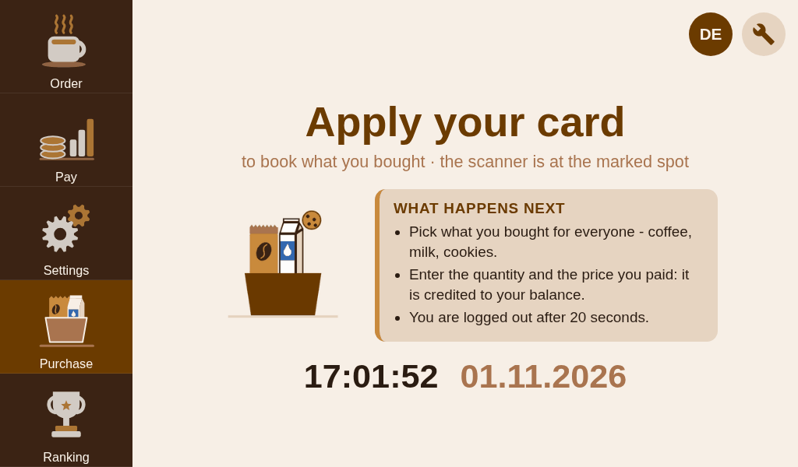
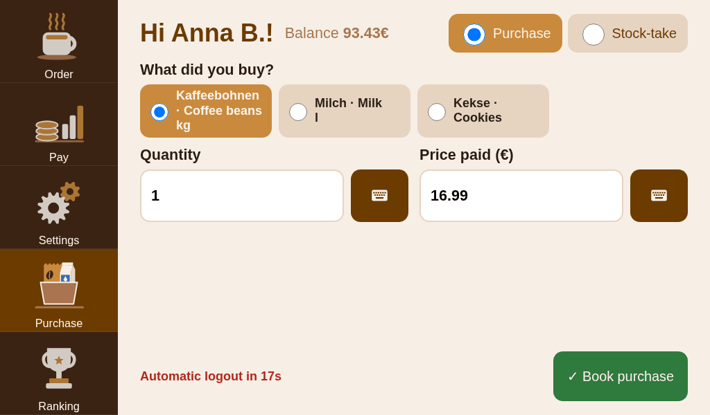
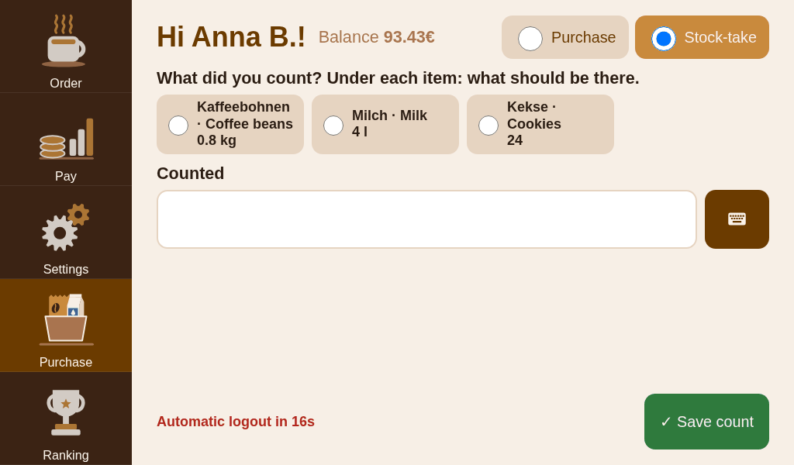
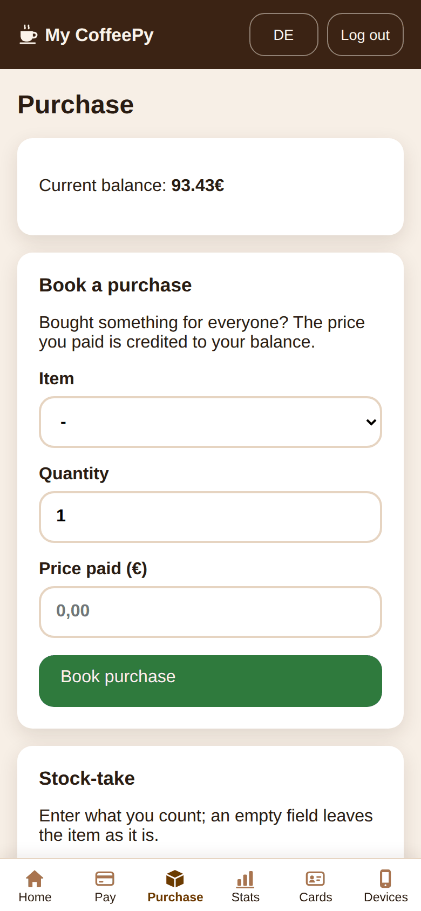
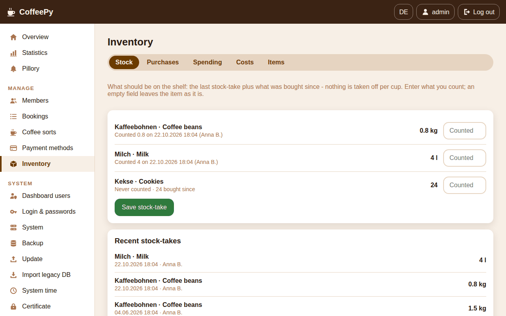
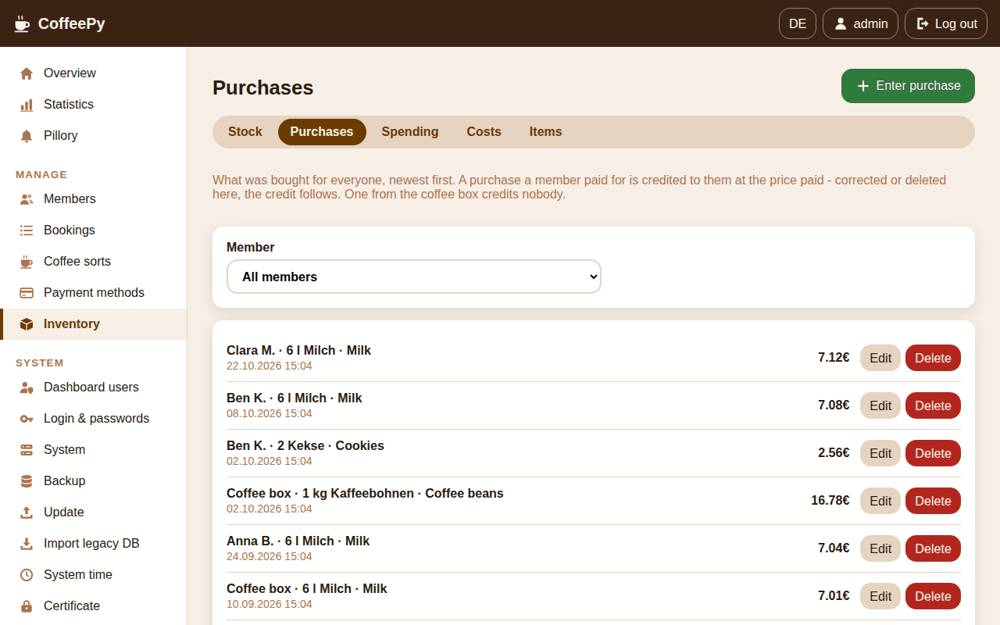
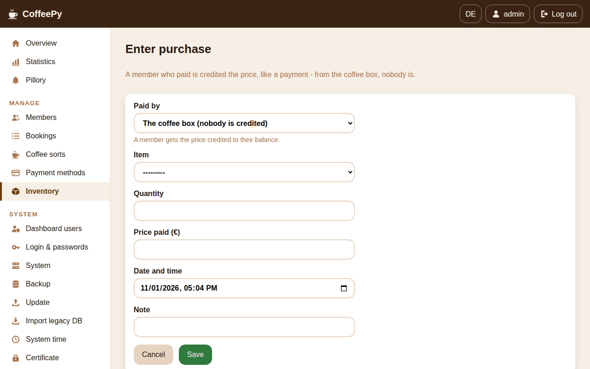
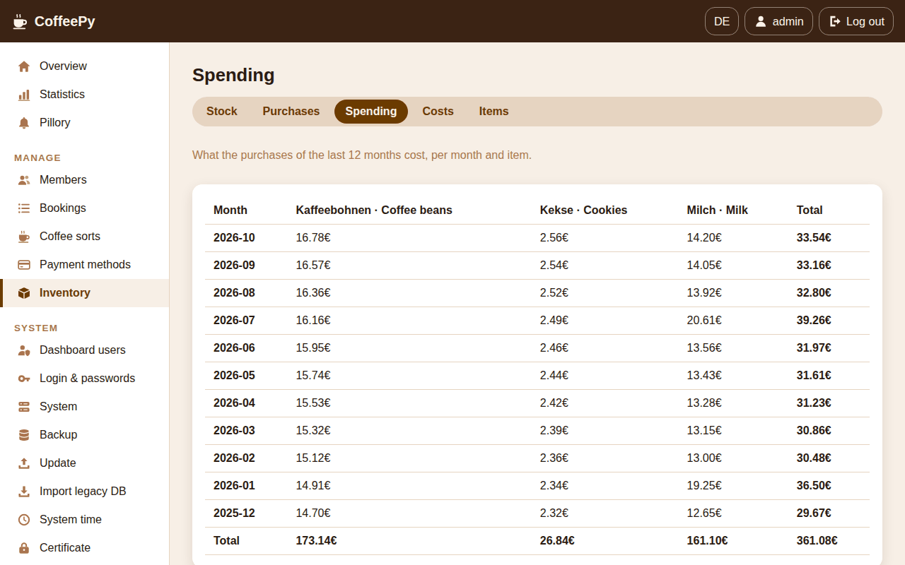
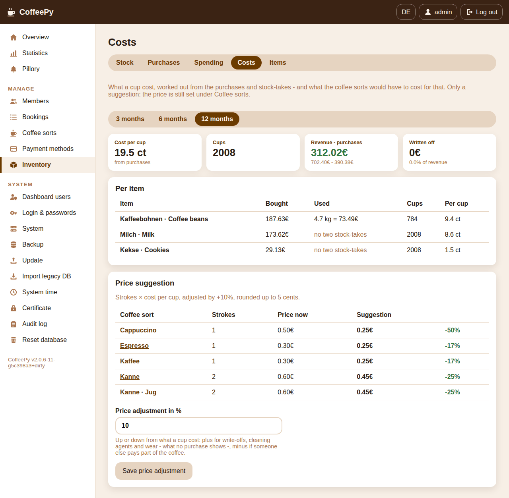
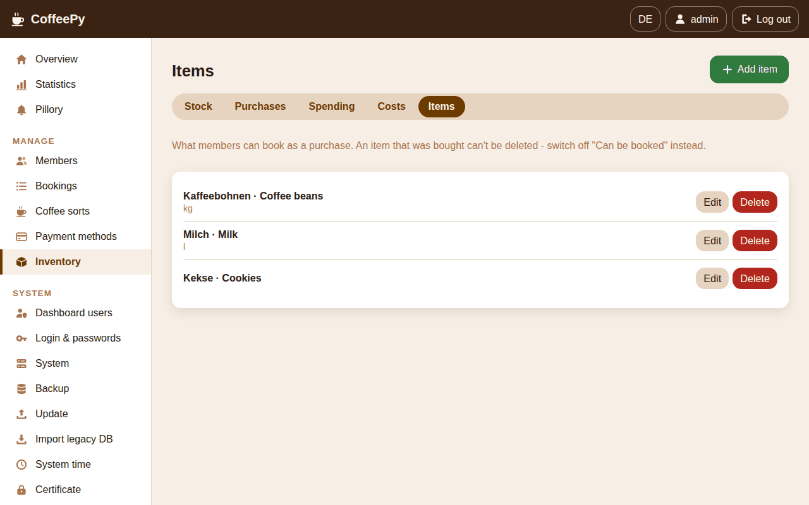

# CoffeePy – User manual

*[Deutsche Fassung](MANUAL.de.md)*

CoffeePy is the tally sheet for a shared coffee machine – without the sheet: whoever takes
a coffee holds their card to the marked spot and taps what they're having on
the touchscreen. CoffeePy keeps count, shows everyone their balance, takes payments, and has
a dashboard in the browser for running it. Members can link their phone to see their stats
and pay from there.

> **Not a point-of-sale system.** CoffeePy only replaces the paper tally sheet. It is not a cash
> register and sells nothing: no receipts, no tax handling, no tamper-proof fiscal records, and
> no payment processing – a payment entered on the kiosk or the phone is a note that someone
> says they paid, and the pay links merely open the member's own app. The balances are an
> informal tally among the people sharing the machine, just like the sheet was. Where coffee is
> sold commercially, a real POS system is needed. CoffeePy comes without any warranty (see the
> [LICENSE](../LICENSE)).
>
> **No liability.** As far as the law allows, the authors accept no liability for damage of any
> kind arising from installing or using CoffeePy – among others lost or wrong data and
> balances, money owed or paid, disputes among members, failed backups or updates, damage to
> the Raspberry Pi, the card reader, the coffee machine or connected devices, and loss of data
> on the SD card or the backup stick. Whoever runs CoffeePy is responsible for checking the
> balances, keeping backups and operating the hardware safely. Liability for intent, gross
> negligence and injury to life, body or health is not affected where the law does not allow
> excluding it.

This manual covers every screen. Technical details are in English under [docs](INDEX.md): the
[architecture](ARCHITECTURE.md), [how the numbers are calculated](CALCULATIONS.md), the
[security mechanisms](SECURITY.md), [GDPR-compliant operation](PRIVACY.md) and the [quickstart](QUICKSTART.md).

**Contents**

1. [What you need](#1-what-you-need)
2. [Installation](#2-installation)
3. [First steps](#3-first-steps)
4. [The kiosk](#4-the-kiosk)
5. [The phone portal](#5-the-phone-portal)
6. [The dashboard](#6-the-dashboard)
7. [Running and maintaining it](#7-running-and-maintaining-it)
8. [When something goes wrong](#8-when-something-goes-wrong)

---

## 1. What you need

| Part | Notes |
|---|---|
| Raspberry Pi | **3 Model B or newer with at least 1 GB of RAM** (3, 3+, 4, 5). A 1 GB Pi 3 is enough but already uses compressed swap; a Pi 4 with 2 GB+ has more headroom. The Zero 2 W (512 MB) is not enough – see [What the device needs](#what-the-device-needs). |
| microSD card | 16 GB or more, preferably A1/A2 – it's the system disk. 32 GB leave room for updates. |
| Power supply | The official one for your model. Cheap supplies are the most common cause of flaky USB devices and touchscreens – the old device with version 1 ran on too little voltage and kept restarting because of it. |
| Heatsink (recommended) | Without cooling a Pi 3 runs at a little over 60 °C in operation; under sustained load 83 °C was measured, just below where it throttles itself. A passive heatsink and vents in the housing are enough. |
| Touchscreen | 1024×600 (e.g. [Adafruit #2396](https://www.adafruit.com/product/2396)). The official 7" display (800×480) works too. |
| NFC reader | **ACR122U** by Advanced Card Systems – the only supported reader. |
| Real-time clock | **DS3231** module with a CR2032 battery, so the Pi keeps the right time without internet. Wire it to I²C-1: VCC→pin 1, GND→pin 6, SDA→pin 3, SCL→pin 5. CoffeePy checks it regularly and warns when it is missing, doesn't answer or has lost the time. **Replace the battery every two to three years**, warning or not (see [When something goes wrong](#8-when-something-goes-wrong)). |
| Cards | Any MIFARE cards or key fobs (ISO 14443A) – one per member. Many company or transit cards work as well. |
| USB stick (recommended) | For automatic backups. Nothing to prepare: you set it up in the dashboard (see [Backups](#backups)) – that erases it. |

### What the device needs

Measured on 29 Oct 2026 on a **Raspberry Pi 3 Model B (1 GB)** running Raspberry Pi OS 13
(64-bit), with a real office's data: 24 members, 8,672 orders since 2023.

| | Kiosk waiting ("apply your card") | Kiosk showing the ranking |
|---|---|---|
| **CPU** (4 cores) | about 0.7 cores – the browser 0.4 of them, the app 0.1 | about 1 core – the browser alone 0.7 |
| **Memory** (905 MB usable) | about 530 MB used, 340 MB in compressed swap, 330–380 MB available | as on the left, the browser needs 60 MB more |
| **Graphics memory** (256 MB) | about 12 MB | about 19 MB |
| **Temperature** without cooling | 60 °C, no throttling | 61 °C, no throttling |

The kiosk's browser needs by far the most: it asks for new cards twice a second and plays
the animations. The app answers it in 0.25 seconds on average. The ranking's animations are
videos rather than GIFs – the same picture for about a seventh less of the browser's CPU time.

**Space on the SD card:**

| | |
|---|---|
| Operating system | 3–5 GB (Lite), more with the desktop |
| CoffeePy's running programs (images) | about 0.9 GB |
| During an update: the new version next to the running one | about 0.9 GB more, until it has come up |
| Database | 12 MB |
| System journal | up to about 50 MB |

On the test device (with the desktop image) 8 GB were used in all. With this data a backup on
the stick is only about **200 KB** – any stick will do.

**Times:** after switching on, the kiosk is ready in about a minute and a half, after a power
cut in up to three and a half. An update takes about seven minutes, the first installation
considerably longer because it builds the app.

### Housing


A 3D-printable housing for the Pi, the 1024×600 display and the reader is in
[housing/](../housing/): print an `LCD_*` frame and the matching `Card_*` holder from
`housing/3D/` (`_H` landscape, `_V` portrait, `_V_T1`/`_V_T2` for printers that need the frame
in two parts); the labels in `housing/labels/` finish it off. Any other housing works just as well.

---

## 2. Installation

You install from a Linux PC with the **provisioning tool**. All the Pi needs is a fresh
**Raspberry Pi OS** with SSH switched on.

### Preparing the Pi

1. Write **Raspberry Pi OS Lite (64-bit)** to the SD card with the
   [Raspberry Pi Imager](https://www.raspberrypi.com/software/).
2. In the Imager's settings, set a **user name and password** and **enable SSH**. The Pi
   needs internet for the installation – a network cable is easiest, otherwise enter your WiFi there.
3. Insert the card, connect display, reader and clock, power the Pi on.

> A network cable is the better choice: at the very end CoffeePy can set up its own WiFi,
> and a connection over the Pi's previous WiFi then drops.

### The provisioning tool

In the CoffeePy directory on your PC:

```bash
./scripts/provision.sh
```

It needs nothing but Bash, SSH and tar, and changes nothing on your PC. Use the arrow keys,
**Enter** and **Esc**.

**Language.** First you pick the tool's language. It is also what the tool suggests as the
device's default language.

<!-- The language screen is bilingual - one picture for both manuals (capture_tui.sh). -->


**Welcome**, then the **Pi's address** (as your router shows it, or `raspberrypi.local`), the
**user** and their **password** from the Imager. The password is kept in memory only and never
written anywhere.


**Checking the Pi.** The tool shows model, system, memory, whether the Pi has internet and how
you are connected – and warns when something doesn't fit (too little memory, no internet, a
connection over the Pi's own WiFi).


If CoffeePy is already installed on the Pi, the tool says so and takes its settings as the
defaults. The database password and internal keys always stay as they are – so you can run
the tool again at any time to change settings or bring in a new version.


**Settings.** Everything that goes into the Pi's configuration, on one page. Pick a line to
change it:


| Setting | Meaning |
|---|---|
| Language | The language kiosk, dashboard and portal start in. Every device can still switch for itself. |
| Admin account | User name and password for the dashboard. A random password is suggested and shown at the end. Only applies when the account is **first** created – change an existing one in the dashboard. |
| WiFi access point | The Pi opens its own WiFi for phones to reach dashboard and portal. Turn it off if the Pi stays on your existing network. At every start it picks the channel (1, 6 or 11) the neighbouring networks disturb least, at the highest transmit power allowed. |
| Address for phones | The address in QR codes and in the certificate. `192.168.4.1` with the access point, otherwise the Pi's (preferably fixed) address on your network. |
| Time zone | For the clock and the statistics by hour and weekday. |
| Backups & audit log | Whether the backups on the USB stick are **encrypted** – on a new installation the tool generates a passphrase, which you can replace or decline; it is shown at the end, keep it somewhere safe: no backup can be restored without it –, and for how many days the **audit log** is kept (90 by default). How often backups are made is set in the dashboard. |
| Updates | Which **signature** an update has to carry: CoffeePy's key, **your own key**, or **no check (development only)** (see [Your own signing key](#your-own-signing-key)). |
| Display | Screen mode. The documented 1024×600 display doesn't report its resolution, so it needs the preset. |
| Web workers | Processes serving the web app: 2 for a Pi 3, 3–4 for a Pi 4 or 5. |
| SSH | **Off after the installation** (the default): nothing on a running kiosk needs it, and with the Imager's password anyone on the network could try to log in. To run this tool again later, an admin switches it on in the dashboard (**System › SSH**). *Stays on* leaves it as it is – for a test device. |
| Install from | Internet, or an offline bundle (for Pis without internet, see the [quickstart](QUICKSTART.md#installing-without-internet)). |

Input is checked right away – a WiFi password, for instance, needs at least 8 characters:


**Installing.** *Install CoffeePy* starts it. The installation runs on the Pi itself, the tool
only shows its progress – if the connection drops or you close the window, it carries on.
It takes 20–40 minutes, mostly for building the app.


**Done.** Finally the tool reboots the Pi (clock, display and kiosk only take effect then),
checks that CoffeePy answers over HTTPS, and shows the credentials – with the backup passphrase
and whether SSH is still on. It can save them to a file only you can read.


> **For several devices** the tool also runs without questions:
> `./scripts/provision.sh --answers answers.txt --unattended`. The keys the file knows are
> listed at the top of the script.

---

## 3. First steps

### Connecting a phone

With the access point, join the WiFi **CoffeePy** (the tool shows the password at the end,
and the kiosk shows it as a QR code, see [Admin access](#admin-access)). Then open
`https://192.168.4.1/` – without the access point, the address you gave during setup.

### Installing the certificate

CoffeePy is only reachable over HTTPS. The device signs its certificate itself, so the
browser warns on the first visit. To get rid of the warning, install the **device
certificate** once per phone or PC: it's linked on the login page (*Download the device
certificate*) and in the portal (*Download certificate*) – directly: `https://192.168.4.1/certificate/`.

- **iPhone/iPad:** open the file → install it under *Settings › Profile Downloaded* → then
  enable the CoffeePy certificate under *Settings › General › About › Certificate Trust Settings*.
- **Android:** *Settings › Security › More settings › Install certificate › CA certificate*
  and pick the downloaded file.
- **Windows:** open the file → *Install certificate* → store *Trusted Root Certification Authorities*.
- **macOS:** open the file (Keychain Access) → double-click the certificate → *Trust: Always Trust*.

If you uploaded your own certificate in the dashboard (see [Certificate](#certificate)),
this isn't needed as long as it comes from an authority your devices already trust.

### Logging in to the dashboard

Open `https://192.168.4.1/` and log in with the admin account. You switch the language below
the login form, and later with **DE/EN** at the top right. If the password doesn't meet the
[login rules](#login--passwords) (any more), the dashboard asks for a new one right after
logging in.


### Setting up

Before the kiosk takes orders it needs at least one **coffee sort** – until then it shows
*Setup needed* with QR codes for WiFi and dashboard.

1. Add **coffee sorts**: name, price and machine strokes (how many cups the machine pours for
   it – a jug counts two).
2. Optionally add **payment methods** (PayPal, PayPal Pool, WERO or a custom link). Cash
   always works.
3. You don't need to add **members**: an unknown card on the kiosk leads straight to
   signing up with a name (see [Settings](#settings)).
4. Plug in a **USB stick** and set it up under **Backup** – from then on the device backs
   itself up (see [Backups](#backups)).

### Moving over from version 1

When CoffeePy replaces a device running the old version 1, you take its data over once –
best at the end of a day when nobody books any more:

1. **Take the database from the running device, not from a copy.** Switch the old device off
   once the last booking is made. The data is on its SD card in
   `/home/<user>/CoffeePy/coffee.db`; a Linux computer reads the card directly, or fetch the
   file over SSH beforehand. An older copy or a backup from the old stick is only a fallback:
   whatever was booked after it is missing otherwise.
2. On the dashboard, under **Import legacy database**, upload the file and tick **Clear
   existing members, cards, … first** – otherwise test bookings and a second import end up
   in the books twice.
3. Look at the newest entries under **Bookings**: if they match the last day on the old
   device, everything is there.
4. **Check the time** (dashboard → **System time**). The clock module usually moves over too,
   and with it the old device's time – which can be wrong after long running without a
   network.
5. **Reconnect the phones:** the WiFi has a new name and a new password, and every phone
   needs the [certificate](#installing-the-certificate).
6. **Announce the new names:** whoever isn't already called "First L." or a short code like
   "AB" – with version 1 almost nobody – is asked for a name at their first coffee on the new
   device (see
   [Settings](#settings)). That takes half a minute at the touchscreen; a note beforehand saves
   puzzled faces in the queue.
7. Set up a **backup stick** (see [Backups](#backups)). Setting up erases the old device's
   stick – if you want to keep its backups, use a new one.

Keeping the old device's SD card until the first weeks have gone well costs nothing.

---

## 4. The kiosk

> For members, the essentials are on one page – for printing and hanging next to the machine:
> [Coffee with CoffeePy – for members](MEMBERS.en.md).

The touchscreen has four sections, in the bar on the left – five when members book their
[purchases](#purchase-and-stock-take) themselves. Round buttons sit top right:
the **wrench** is the [admin access](#admin-access) – it isn't meant for members –, **DE/EN**
switches the kiosk's language, and a **blinking red** button appears when something on the
device needs looking after – an **amber** one when an admin has something to decide:

| Sign | Meaning |
|---|---|
| Red, database symbol | **Backups are not running** – the backup stick is missing, or the last backup failed. Details under **Backup** in the dashboard. |
| Red, clock symbol | **The clock module (RTC) is faulty** – missing, not answering, or its battery is flat –, or **the clock was wrong and has been put forward**. Details on the dashboard's **Overview**. |
| Amber, clipboard | **A task for the admin**: departed members are suggested for deletion (see [Members](#members)). It shows no names and goes once each of them is deleted or kept – or once the period is set to 0. |


Every section but the ranking needs a card – one held up on the ranking starts an order, as on **Order**. **Tap the section first, then hold up your
card** – what counts is the section the screen shows; the start screen is **Order**. Holding up a card logs you in until you're done; after
**20 seconds without input** the kiosk finishes for you – on **Order** it **books** the
preselected coffee (unless you tap **Cancel**), everywhere else it logs you out. A red countdown next to the buttons
shows how long is left. Tapping a section in the bar logs out too. **Pay**, **Settings**, **Purchase** and the **Ranking** go back to **Order** by
themselves after 30 seconds without a tap – so the next person always finds the kiosk ready to
order.

### Order

The start screen. It explains what happens when you hold up your card and shows the time.


After the card, the kiosk greets you by name. Your favourite coffee is preselected; tap another
one to switch. **Order now** books right away. **Cancel** cancels the order: nothing is booked,
and you are logged out. If you tap nothing at all, the kiosk books your favourite coffee after
20 seconds – coffee in one move: card, cup, done. Picking a different sort turns the automatic
booking off – then you confirm yourself; the countdown starts again from your pick and logs you
out, booking nothing.

> **Only looking, not ordering:** your balance and cups are under **Pay**, your name and
> favourite coffee under **Settings** – tap the section first, then hold up your card. No
> coffee is ever booked there. Booking by itself only happens on **Order**, and only if you tap neither
> **Cancel** nor another sort. If something was booked wrongly anyway, tell an admin – they
> correct it under [Bookings](#bookings).

With **more than 12 sorts** they don't all fit on the screen and come in pages: **For you**
first – your favourite, the sorts you order most, then the ones everyone orders most – and
**More sorts ›** turns to the rest, alphabetically (**‹ Back** turns back). Your favourite is
always on the page you see first; turning a page counts as choosing, so nothing is booked by
itself any more.

The medals next to your name show a place in the top 3 – all time
and this month. Whoever still owes money from last month gets a reminder here.


Then a thank-you – with a different animation depending on how many cups it's been today.


### Pay


This is where you pay in. For information, the screen also shows your **cups in total**
and **this month** and your **balance**. If it's
negative, the amount owed is already in the field – enter what you paid, pick how, and tap
**Pay**. With payment methods that have a link, you can also pay what you owe straight from
your phone via QR code.


### Settings


Change your **name** and **favourite coffee** here and tap **Save**. Type directly, or use
the on-screen keyboard via **Keyboard** – it has umlauts, ß, hyphen and full stop too. The
favourite coffee is a tile per sort – with more than 12 sorts grouped like on **Order**.

The name is **first name and the first letter of the last name**, like *Anna B.*, or a **short
code** of two to four capitals, like *AB* – so everyone knows who is on the ranking and the
pillory. The kiosk adds capitals and the full stop itself (*anna b* becomes *Anna B.*). It refuses placeholders (*Test*, *Name*, *Coffee* …), keyboard
mashing (*Asdf*) and a name somebody already has – a second letter helps then: *Anna Be.*
Whoever's name doesn't fit – including those still named after their card number – is **asked
for a name first** at their next coffee (*Who are you?*) and orders after that; saving goes
straight on to the order. The field already holds what can be made of the old name – *Anna*
becomes “Anna ” with the cursor after the space, so only the letter is missing. A name that only lacks the form (*Anna B* without
the full stop) is put right by the kiosk without asking.


A card the kiosk doesn't know yet lands here automatically: saving creates the new member.


**Link this phone** shows a QR code that connects your phone to your account (see
[phone portal](#5-the-phone-portal)). It's valid for five minutes and works once. With the
access point, the WiFi's QR code sits next to it – the phone has to join that first.


### Purchase and stock-take

Only there when the admin has switched purchases on for members (dashboard → **System** →
*Purchases and inventory*, see [Inventory](#inventory)). Whoever buys something for everyone –
coffee beans, milk, cookies – books it here and is credited the price they paid, like a payment.



After holding up your card, tap what you bought, enter the **Quantity** and the **Price paid (€)**
– directly or with the on-screen keyboard next to the field – and tap **Book purchase**. The kiosk
confirms what was booked, with your new balance. The choice is what the admin has entered as
bookable under **Inventory** → *Items*. A new card, or a name that doesn't fit the rules, is asked
for a name first; after saving it goes straight on to the purchase.



Members marked *May take stock* in the dashboard also get the choice of **Purchase** and
**Stock-take** at the top. Under **Stock-take** each item shows what should be there according to
the bookings: tap the item, enter under **Counted** what is really there, **Save count**. CoffeePy
takes nothing off per cup – the stock is the last count plus everything bought since.



### Ranking

No card needed. Up to three tabs at the top (which ones is the admin's decision, see below), each with its own retro animation; the names are in the
bar underneath. Counted are cups – a jug is two.

- **All time** – the podium: the top 3 since the start, first in the middle.

  

- **This month** – the month isn't over yet: the current top 3 stand by while a fourth runs
  up, vaults over a swivel chair to the coffee machine and waits for the judges' scores.

  

- **Pillory** – the seven who owe the most up to last month, as a walk of shame; their
  names and amounts run through the bar underneath. When everyone has paid, the banner says
  **NO SHAME** and the executioner stands on an empty scaffold with nothing to do.

  

Opening the ranking always starts on its first tab.

**Whether there is a ranking and a pillory is the admin's decision** (dashboard → **System** →
*Ranking and pillory*): with the ranking off, the *All time* and *This month* tabs and the
medals on the order screen are gone; with the pillory off, its tab; with both off, the
**Ranking** button too. A newly set-up device starts with both
off; see [Privacy and the workplace](#privacy-and-the-workplace).

### Admin access

The round wrench top right is for whoever looks after the device: it shows two QR codes, one to
join the device's WiFi and one that opens the dashboard – the touchscreen itself has no keyboard,
after all. Members don't need it; they link their phone under **Settings**.


### "We'll be right back"

During an installation, an update or a restore – and whenever the app briefly doesn't answer –
the kiosk shows this screen and takes no input. Once the work is done, it reloads by itself;
the same goes for an error page.


---

## 5. The phone portal

Every member can link their phone: on the kiosk, hold your card up under **Settings**, tap
**Link this phone** and scan the QR code with the camera. The phone then stays logged in for
six months (extended every time it's used). Switch the language top right; it applies to this
phone only. **Log out** next to it ends the link on this phone.

**Home** shows cups, balance and the latest orders and payments. At the bottom of the page:
**Download my data** – everything the device stores about you, as one file (people who changed
something about you, an admin say, appear by their role only) – and the device certificate.


**Pay** opens your payment app with the amount owed, or records a payment you've already made.


**Stats** compares you with everyone else: cups per month, time of day, weekday and sort.


**Purchase** – only when members book purchases themselves: enter the item, quantity and price
paid, **Book purchase**, and the price is credited to you; below, your recent purchases. Members
who may take stock also enter the counted quantities here, under **Stock-take**.



**Cards** lists your cards; *Add a new card* links a replacement by holding it to the kiosk.
**Devices** lists your linked phones – log out a lost one there.


A link that has expired or was already used ends up here – just create a new one on the kiosk.
After ten invalid links within 15 minutes, a phone gets no more links accepted for up to a quarter of
an hour – so nobody can try out links at random.


### How linking works – and why it is safe

The portal has no passwords. Instead the kiosk hands the phone a **one-time link**:

1. **Only with your card, only at the device.** The QR code under **Link this phone** only
   exists while you are logged in on the kiosk with your card. The kiosk itself can only be
   reached from the touchscreen, not over the network – nobody can request a link for
   someone else from their phone or PC.
2. **A random token, not a password.** The link contains 256 bits from a cryptographic random
   generator (43 characters). It can't be guessed or worked out, not even with unlimited
   attempts in the five minutes it is valid.
3. **Five minutes, once.** The link expires after five minutes and is deleted the moment it is
   opened – a second scan gets *Link no longer valid*. A new link replaces any older one the
   member hasn't used yet.
4. **The phone gets its own login.** Opening the link starts a fresh session on that phone:
   a cookie that only travels over HTTPS (encrypted, checked against the device certificate)
   and that the page's scripts can't read. It stays valid for six months and is extended
   every time it's used; the link itself is worthless from then on.
5. **Everything can be undone.** Every linked phone appears under **Devices** in the portal
   and can be logged out there; an admin does it for all of a member's phones with **Revoke
   devices**, and a member marked as departed is logged out everywhere. Issuing the link,
   every login and every failed attempt land in the [audit log](#more-system-pages).

**What a phone can do there** – and therefore what a stranger could do with someone else's
phone: see that member's cups, balance and bookings, compare them with the others' totals,
record a payment *they say* they made, and start adding a card – which then still has to be
held to the kiosk. No money moves: a payment entered in the portal is a note like on the
kiosk, it shows up under **Bookings** and in the audit log, and an admin can correct it.
Dashboard and kiosk can't be reached with a portal login.

**The one thing to keep in mind:** whoever photographs the QR code within those five minutes
and opens it first gets that member's portal instead of them. The member notices right away
(their own scan says *Link no longer valid*), the phone shows up under **Devices**, and one tap
logs it out again. So: scan it yourself, right away, and close the window afterwards.

---

## 6. The dashboard

The dashboard is at `https://<address>/dashboard/`. On a PC or tablet its pages are in the bar
on the left; on a phone the everyday ones are tabs at the bottom and everything else is under
**More**.


There are two roles (see [Dashboard users](#dashboard-users)): **Managers** look after members,
bookings, coffee sorts, payment methods and the inventory; **Admins** can also do everything under **System** –
users, login rules, backups, updates, certificate, audit log and the like. The admin account from
setup is an admin. There is no other administration interface.

**Overview** shows the most important numbers, buttons to enter a payment or add a member, and
the **Device** card: is the card reader online, are backups running, is the clock module (RTC)
fine, and under which address phones reach the device. Something red here needs looking after –
the same things blink red on the kiosk. **Exports** downloads *All orders (CSV)* or *All
payments (CSV)* for a spreadsheet.


### Statistics and pillory

**Statistics**: orders and payments (in €) per month over the last 12 months, sort
distribution, cups by hour and weekday (the titles name the busiest slot), price trend and
payments by method. Once purchases are booked, they come in as a third bar – kept apart from the
payments, which show the money that came in. Cups count machine strokes – a jug is two; the sort distribution counts
orders (a jug once, see [the calculations](CALCULATIONS.md)).


**Pillory**: every member with a negative balance, counted up to last month – the kiosk's
pillory shows the seven largest of them.


### Members

The list of all members with their cards and the day of their **last coffee** – which tells
you, even for a card without a name, whether someone still uses it or its owner left long ago
(then *Mark as departed*). Per member:

- **Edit**: name and favourite coffee (the UID is fixed once the member exists), and when members
  book purchases themselves *May take stock* (see [Inventory](#inventory)). The name follows the same rules as at the kiosk
  (see [Settings](#settings)).
- *New name at next coffee*: this name doesn't fit the rules – the kiosk asks the member for
  a new one at their next coffee.
- **Bookings**: this member's orders and payments (see [Bookings](#bookings)).
- **Add card**: the next card held to the kiosk within a minute becomes this member's – that's
  how someone gets a replacement card without ending up with a second account.
- **Revoke devices**: logs out all linked phones.
- **Mark as departed**: writes off the balance and blocks the cards; *Reactivate* undoes it.
- **Delete**: removes the member with their cards, orders and payments – for good, apart from
  the backups.
- **Export data** (also on the member's edit page): everything the device stores about this
  member – cards, linked phones, every order, payment and purchase, their audit log entries – as one
  file. That is the answer when someone asks what is stored about them (Art. 15 GDPR).


**Merge members** helps when two accounts did end up existing: all orders, payments and cards
move to the account you keep, the other one is deleted – its card becomes an extra card of the
kept one, which takes the name of whichever account was used last.


Under **Names** (admins only) you enter **blocked first names** (or short codes), one per line – on top of the
usual placeholders, which are always refused. Meant for what only someone on the team would
think of (*Boss*, the coffee machine's name …). Whoever already goes by one of them is asked
for a new name at their next coffee.

Under **Departed members** (admins only) you set after how many months a departed member is
**suggested for deletion** – only those whose balance is settled: whoever still owes money, or
has credit left, isn't suggested. 0, the default, means never. The suggestions appear at the
top of the page under **Suggested for deletion**, as a row on the **Overview** and as an amber
sign on the kiosk. **Nothing is deleted by itself**: the period is measured with the device's
clock, and a clock module with a flat battery can put that wrong – check the departure date,
then **Delete** (with cards, orders and payments, in the **Audit log**) or **Keep**: the browser
asks why (*comes back in spring*, *an open bill is being settled* …), and without a reason
nothing is kept. Kept members are listed under **Kept** with the reason, who kept them and when,
and are no longer suggested; **Suggest again** undoes it, and so does *Reactivate*. Backups
still hold a deleted member until they are thinned out.

### Bookings

Every coffee booked and every payment – two tabs, **Orders** and **Payments**, newest first, 50
per page – filterable by member (with their balance).
Here you correct a wrong booking (**Edit**, **Delete**) and record a payment that didn't go
through the kiosk – **Enter payment**, e.g. cash put in the till. Every change is recorded in
the audit log.


### Coffee sorts and payment methods

**Coffee sorts**: what the kiosk offers – name, price and machine strokes.


**Payment methods**: PayPal needs the paypal.me name, PayPal Pool the pool's URL, WERO the
phone number; *Custom link* takes any address, optionally with `{amount}` for the amount owed.
These become the pay links and QR codes on kiosk and phone – WERO has no public link, so it
shows the phone number as an instruction instead of a QR code. *Is active* hides a method
without deleting it, *Order* sets its place in the list.


### Inventory

What is bought for everyone – coffee beans, milk, cookies – with its price, the stock, and what a
cup really costs. The inventory only exists once an admin has switched it on under **System** →
*Purchases and inventory*, at one of two levels:

| Level | What there is |
|---|---|
| *Off* (default) | none of it |
| *Only in the dashboard* | One person keeps purchases and stock-takes here in the dashboard. Members can't pay with purchases; kiosk and portal show none of it. |
| *For members too* | On top, every member books their purchases at the kiosk and in the portal and is credited the price; members marked *May take stock* (see [Members](#members)) count the stock there too. |

Switched off, purchases already booked stay credited in the balance. The inventory has five tabs:

**Stock**: what should be on the shelf – the last stock-take plus everything bought since; nothing
is taken off per cup. To count, enter what you counted for the items and tap **Save stock-take**;
an empty field leaves the item as it is. Below, the recent stock-takes and who counted.



**Purchases**: everything bought, newest first, filtered by member or *Coffee box*. **Enter
purchase** adds one. Under **Paid by** you pick the member who paid – they are credited the price
– or *The coffee box*: then nobody is credited, and the purchase only counts for the stock, the
spending and the costs. Correct or delete a purchase and the credit follows; under **Bookings**,
*Edit* on a purchase's payment leads here too.





**Spending**: what the purchases of the last 12 months cost, per month and item.



**Costs**: what a cup cost and what the coffee sorts would have to cost for that, over 3, 6 or 12
months. At the top the **Cost per cup**, the **Cups**, *Revenue - purchases* – does the box pay
for itself? – and what departed members left owing (**Written off**). *Per item* shows what the
costs are made of: with two stock-takes of an item in the period, what was **used** between them
counts – a bulk purchase still in the cupboard doesn't make the cup dearer –, otherwise simply
what was bought.

The **Price suggestion** is strokes × cost per cup, adjusted by the *Price adjustment in %*,
rounded up to 5 cents, next to the current price. The adjustment goes both ways, from −100 to +100
(default +10): a plus for write-offs, cleaning agents and wear, which no purchase shows, a minus
when someone else – the company, say – pays part of the coffee. It only appears once there were purchases in at least 3 months of the period and 100 cups
were drunk. It stays a suggestion, the price never changes by itself: you set it under **Coffee
sorts** (the sort's name leads there), and orders already booked keep their price. The calculation
in detail is in [the calculations](CALCULATIONS.md#purchases-stock-and-the-price-suggestion).



**Items**: what can be booked – name, *Unit* (*kg*, *l* …), *Can be booked* and *Order*. An item
that has been bought can't be deleted; untick *Can be booked* instead.



### My account

Your name at the top right: your role, your last login, and **Change password**. Your own password is only changed here, never in the user list.


### Dashboard users

Who may log in to the dashboard – admins only. **Add user** asks for a user name, the role
(**Admin** or **Manager**) and a first password; tick *Must set a new password at the first
login* to hand it over as a one-off password. Per user: **Edit** (unticking *May log in* locks the
account without deleting it), **Set password** (for a forgotten one), **Delete**. Nobody can
lock, delete or demote themselves. A user locked after too many failed logins is marked *locked*.


### Login & passwords

The rules for logging in. The defaults follow the BSI's recommendation and can only be set
within sensible limits:

| Rule | Default | Possible |
|---|---|---|
| Minimum length | 12 characters | 8–64 |
| Character kinds (lower case, upper case, digits, symbols) | 3 | 1–4 |
| … or a long passphrase of at least | 20 characters with 2 kinds | off, or longer than the minimum length up to 128; 1–4 kinds |
| Lock after failed logins | 5 | 3–20 |
| Locked for | 15 minutes | 1–1440 |
| Logged out when idle for | 30 minutes | 5–480 |

Passwords are at most 128 characters long. When the rules get **stricter**, nobody is locked
out: whoever's password no longer meets them is asked for a new one at their next login.


### System

**System** shows the device's CPU, memory and disk.


**Ranking and pillory**: what the kiosk shows everyone at the machine – the ranking (who drinks
the most, all time and this month) and the pillory (who owes money), each with a tick. The
kiosk follows with its next poll. The dashboard's **Pillory** page, for whoever collects the
money, is not affected. See [Privacy and the workplace](#privacy-and-the-workplace).

**Purchases and inventory**: *Off*, *Only in the dashboard* or *For members too* – what the levels
mean is under [Inventory](#inventory). A new device starts with *Off*; the kiosk follows with its
next poll.

**SSH**: remote login to the device's operating system. It is off after the installation and
only needed to run the [provisioning tool](#the-provisioning-tool) again or for maintenance:
**Switch SSH on**, and it stays on – across restarts too – until **Switch SSH off**. While it is
on, a warning says so (as in the picture above); both show up in the **Audit log** as
*ssh.enable* / *ssh.disable*.

If a note under the address says it was *only guessed*, `PUBLIC_HOST` in `.env` is empty and the
address is probably the app container's – the QR codes then lead nowhere. The provisioning tool
and the installer set it; by hand: `PUBLIC_HOST=` with the device's address.

**Night rest**: with *Switch the kiosk off at night* the kiosk darkens its screen at *Off from*
(say 20:00) and comes back by itself at *On again from* (say 05:30). For *Saturday and Sunday*
choose *Like the weekdays*, *Off all day* or *Times of its own* (*Weekend: off from* / *on again
from*). A night belongs to the day it starts on: Friday night runs to Saturday morning by the
weekday times, and after a Sunday that was off all day the kiosk comes back on Monday at *On
again from*. At night, cards at the machine are **not booked** – not later in the morning
either. The phone portal, the backups and the dashboard keep running. A change takes effect
within a minute and shows up in the **Audit log** as *night.update*.

**System time**: only needed when the clock module is missing or wrong. The new time is
also written to the clock module within ten minutes.

Without a network nobody puts the clock right – so the device itself makes sure it doesn't
go **back**: if it jumps back, or stands before the newest entries in the audit log (every
booking writes one), it is put forward again and the kiosk shows the red clock sign. The
overview then says from when to when. Check the time and set it here, or confirm it with
**The time is right** – the sign goes away. It is never put back: a clock that is ahead
can't be told from a right one. With internet access the device sets its clock itself anyway,
and this check stays out of it.


#### Backup

Everything about the backup stick (see [Backups](#backups) for how it works):

- **This device's backup stick** – space, whether the backups are encrypted, **Back up now**,
  **Eject safely**, and the backups on it, each with **Download** and **Restore**. *checked*
  means its checksum is fine, *damaged* that it isn't.
- **USB sticks** – a stick that isn't set up yet: **Set up as backup stick**. A stick from
  before (of this device) or of another CoffeePy can be read, and taken over with **Use for
  this device**.
- **When and what is kept** – how often (every 15 minutes to once a day) and how many backups
  stay: the newest ones, then one per day, week and month.
- **Restore a backup** – from the stick, or **Restore from a file**.
- **Download a backup** – the whole device as it is right now, as a file, also without a stick.

While the backups are not encrypted, the page says so in a highlighted note.


When restoring you choose **what**: the data (members, bookings, coffee sorts, dashboard logins),
the certificates and device CA (phones keep trusting the device), the device identity (its
backup stick becomes this device's) and the settings (language, address, time zone, log
retention). To confirm you type `DELETE`. Before anything changes, the current state is saved
– to the stick, or to the SD card without one; if the restore fails, nothing is changed. An encrypted backup needs the passphrase.


#### Update

Upload an update bundle and follow it being installed (see [Updates](#updates)). There is no
way back to an earlier version by hand. **Versions** lists exactly what runs on the
device: the CoffeePy version and its commit, Python, Django, the database, the operating
system, Docker, and every container with the id of its image – **Copy all** puts the whole list
on the clipboard, ready for a bug report. The CoffeePy version alone is also at the bottom of
the dashboard's navigation, at the bottom of the phone portal, and on the kiosk below the QR
codes for the admin area (the wrench). **Operating system** explains OS bundles (see
[Operating system updates](#operating-system-updates)) and offers **Download the installed
packages** – the device's own package list, to build one from; *OS bundle* under **Versions**
names the last one installed.


#### Certificate

Shows which certificate is in use. You can upload **your own certificate** (PEM, with chain,
plus the unencrypted private key); it's live within seconds. CoffeePy checks that key and
certificate belong together and warns if it doesn't cover the device's addresses. A button
goes back to the self-signed certificate. The kiosk on the device always keeps the device's
own certificate – a bad upload can never lock it out.


#### More system pages

**Import legacy DB**: takes over the data of an old CoffeePy (V1) – a `coffee.db` or one of
its backups. The import keeps running in the background even if you close the page.


**Audit log**: everything that happened on the device – logins and failed logins, every change
in the dashboard, bookings and settings on the kiosk and in the portal, backups, restores,
updates, the backup stick and the clock module. Per entry: when, who, from where, what, and
whether it succeeded. **Search** and the filters narrow it down, **Export (CSV)** downloads
what's shown. Entries are deleted after the retention period (90 days by default, see
[provisioning tool](#the-provisioning-tool)).


**Reset database** deletes **all** coffee data (members, cards, orders, payments, sorts,
payment methods, audit log). Dashboard logins stay. To confirm you have to type `DELETE` –
take a backup first!


---

## 7. Running and maintaining it

### Changing settings

Simply run the [provisioning tool](#the-provisioning-tool) again: it reads the existing
configuration, you change what you want, and it applies the change – the kiosk shows "We'll be
right back" meanwhile. Data, database password and certificate are kept. First switch SSH on in
the dashboard (**System › SSH**) – the tool connects over it, and switches it off again at the
end unless its *SSH* setting says *stays on*.

### Backups

The device backs itself up to **one USB stick** that you set up for it:

1. Plug in a stick and open **Backup** in the dashboard.
2. **Set up as backup stick** – after a confirmation the stick is **erased**, formatted and
   marked as this device's. Backups start right away.
3. From then on the device makes a backup at the interval you set (hourly by default) and
   thins them out: the newest 48, then one a day for 14 days, one a week for 8 weeks, one a
   month for 12 months.

A backup holds the whole device: the data, the device CA and certificates, and its settings –
so a replacement device can take over completely. Every backup is read back and checked after
writing. With the passphrase from the [provisioning tool](#the-provisioning-tool) – it generates
one unless you decline – it is encrypted (AES-256); without one, anyone who takes the stick can
read it, and the **Backup** page says so.

- **Stick pulled out?** The overview and the kiosk show that backups aren't running. Plug the
  **same** stick back in, and everything carries on as before.
- **New stick?** It has to be set up like the first one. The old one is forgotten: the device
  still reads it, but never writes to it again.
- **Restoring** is described under [Backup](#backup). A restore also replaces the dashboard
  logins – you may have to log in again afterwards.

### Updates

The device needs no internet for updates. On a PC with internet and Docker (or Podman):

```bash
./scripts/update_builder.sh
```

The **update package builder** asks what goes into the bundle – platform, the device's own
services, operating system packages for an offline device –, which signing key to use (it
creates one on the first run), and where the bundle goes. It builds and signs the bundle and
can upload it to a device's dashboard right away and follow it being installed.


Otherwise upload the bundle in the dashboard under **Update**. The device then:

1. checks the **signature** and every file's checksum, that the bundle is meant for this device,
   that there is room, and that it isn't older than what's installed – the one exception: a
   device running a pre-release (a test build, its version has a "-" such as 2.1.0-beta.3) takes
   a release of the same major version, 2.0.2 say; the device first takes its database back to
   what that release knows,
2. saves the database and the running version **to the SD card** (never to the backup stick),
3. installs it – the kiosk shows "We'll be right back" with a progress bar, the update page the log,
4. checks that the new version answers. If it doesn't, the previous version **goes back
   automatically**, data included.

Once the new version has come up, the copy of the previous one is deleted: **updates only go
forward**. Something wrong with a version is fixed by the next update, not by going back – there
is no button for that (a test build going back to its release, see above, is the one exception). The database dumps under *Saved before updates* stay on the SD card as
copies of the data.

**A power cut during an update** does no harm. When the device starts again, it first puts the
version from before the update back, data included (the kiosk shows "Repairing an interrupted
update"), and then installs the same bundle again from the start – at most three times. A
bundle that failed on its own, rather than because of the power cut, is not retried.

For scripts there is `./scripts/build_update_bundle.sh` (its options are listed at the top of
the script); an update also works from a PC through the provisioning tool.

#### Operating system updates

An update bundle brings CoffeePy; the device's **operating system** – kernel, firmware, browser,
SSH, Docker – is Raspberry Pi OS, and an offline device only gets its security updates through
an **OS bundle**. Building one is up to you: CoffeePy runs on more than one kind of hardware,
and only you know what your device's system should carry.

1. In the dashboard under **Update**, **Download the installed packages** – the device's own
   list (`coffeepy-os-packages.txt`).
2. On a PC with internet and Docker: `./scripts/build_os_bundle.sh --packages
   coffeepy-os-packages.txt` (`--release` if the device doesn't run trixie). It fetches the
   newest versions from the Raspberry Pi OS archives and writes
   `coffeepy-os-<release>-<date>-arm64-unsigned.tar`.
3. Sign it like any bundle: `./scripts/sign_update_bundle.sh <file> --key
   ~/.config/coffeepy/update-signing.key`.
4. Upload it under **Update**.

The device checks it like an update – signature, checksums, platform, space, that it is newer
than the last OS bundle, and that it was built for the system the device runs. It saves the
database to the SD card, installs the packages and, if a new kernel or firmware came with them,
**restarts** by itself; "We'll be right back" stays up meanwhile. Only what is installed is
updated – new packages come in only as dependencies those need.

- **There is no way back** from an OS update – the database copy is the safety net.
- *Some packages were kept back*: something installed needs exactly the old version of a package
  (`libexpat1-dev` holds `libexpat1`, say). The log names them; put what depends on them on the
  list too and build again.
- **A power cut** during an OS update: at the next start the device finishes what it had begun
  and doesn't start over by itself. Upload the same bundle again to complete it.

#### Updating from the GitHub release

Every build on GitHub is waiting under *Releases* – the newest is marked *Latest*. The update
bundles there are **unsigned**, because the key is never at GitHub. For a device in use, you
sign the bundle yourself, with your own key (see [Your own signing key](#your-own-signing-key)
– the device has to trust it):

1. Download `coffeepy-update-<version>-arm64-unsigned.tar` and `sign_update_bundle.sh` from the
   release.
2. Sign it: `bash sign_update_bundle.sh coffeepy-update-<version>-arm64-unsigned.tar --key
   ~/.config/coffeepy/update-signing.key`. The script first checks every file of the bundle
   against its checksums, then writes `coffeepy-update-<version>-arm64.tar` and names your
   key's fingerprint – the same must be under **Update › Versions** (*Update signature*).
3. Upload the **signed** bundle in the dashboard under **Update**.

Installing the unsigned bundle directly only works with the check turned off (see below) –
**for development only**, on a test device.

#### Your own signing key

A device only installs updates whose signature matches its key – by default the key that comes
with CoffeePy (`install/update-signing.pub`). If you build updates yourself, use your own:

1. **Create a key pair** on the PC where you build the updates:
   `./scripts/update_signing_key.sh` – the private key goes to
   `~/.config/coffeepy/update-signing.key` (or the path you give it) and **never leaves that
   PC**; the public key is written to `install/update-signing.pub`.
2. **Put the public key on the device** – one of two ways:
   - in the [provisioning tool](#the-provisioning-tool) under **Updates › Own key**, pick the
     public key file (`.pub`). It ends up on the device as
     `/etc/coffeepy/update-signing.own.pub`, takes precedence over CoffeePy's key, and **no
     update replaces it**. **CoffeePy's key** there removes it again.
   - or install from your own checkout with your `install/update-signing.pub` committed –
     then it is the device's key from the start, and every update built from that checkout
     brings the same one along.
3. Build updates with that key: the builder asks for it (*Signing key*), the script takes
   `--key FILE`.

The fingerprint of the key in use is shown under **Update › Versions** (*Update signature*).

**Switching the check off completely – for development only:** in the provisioning tool
**Updates › No check (development only)**, or
`UPDATE_VERIFY_SIGNATURE=false` in `/opt/coffeepy/.env` on the device. The device then
installs every bundle – signed, signed with another key, or not signed at all
(`build_update_bundle.sh --unsigned`). The checksums, the platform and the space are still
checked. Only do this on a test device where nobody you don't trust can log in as an admin:
whoever can upload an update can then run anything on the device. The dashboard's update page
warns for as long as the check is off.

### When the kiosk hangs

Every minute the device checks that the app answers and that the kiosk's browser still asks
it for new cards. If something hangs, it restarts it, a step at a time: the kiosk screen
first, then, if that didn't help, the app. If the app doesn't answer for three minutes, it
restarts that right away. Each takes a minute or two and shows up in the **Audit log** as
*watchdog.kiosk_restart* / *watchdog.stack_restart*.

It stays out of updates, restores and imports, the first minutes after switching on and – for
the kiosk – the night rest, and
after three restarts within an hour it gives up (*watchdog.gave_up*): a restart doesn't help
then, and it is time to look at the audit log. Pulling the plug is only left for when even
that has no effect.

### Keeping it safe

- **Not on the internet.** The device belongs on your own network or its own WiFi. Never make
  the dashboard or port 443 reachable from outside (no port forwarding in the router).
- **SSH off** while nobody needs it (dashboard → **System**), and a strong password for the Pi's
  user.
- **Signed updates only** – the check stays on, see [Your own signing key](#your-own-signing-key).
- **Encrypted backups** – keep the passphrase apart from the stick.
- **Operating system updates** from time to time, see [Operating system updates](#operating-system-updates).
- **Taking a device out of service**: **Reset database** (dashboard → **System**) only empties
  the database – the SD card still holds the old blocks, and the backup stick its backups. Wipe
  or destroy the SD card and the stick before they leave your hands, or keep the stick as you
  would the data itself.

### Privacy and the workplace

CoffeePy processes personal data about colleagues: name, card id, every order with its time,
payments and balance, and in the audit log who did what in the dashboard (with IP address, 90
days by default). At work, consumption and debts are personal data – in Germany the GDPR
applies, and as soon as something looks like data on behaviour or performance, a **works
council** may have a say (§ 87 (1) no. 6 BetrVG: technical facilities *suited* to monitor
behaviour or performance – whether that is the intention doesn't matter).

What helps, without being legal advice:

- **Switch the ranking and the pillory on deliberately** (dashboard → **System**) – a new
  device has both off. The pillory in particular shows everyone at the machine who owes money.
- **Inform people first**: who sees which data, what it is for (the tally) and how long it is
  kept (Art. 13 GDPR); where there is a works council, involve it before switching the ranking
  or the pillory on.
- **Allow short codes**: whoever doesn't want their name in the ranking takes a code like "AB"
  (see [Settings](#settings) at the kiosk).
- **Mark people who left** (dashboard → **Members**): their cards are blocked, and they no
  longer appear in the ranking or the pillory. Under **Departed members** you have them
  suggested for deletion after a period of your choosing.
- **Someone asks what is stored about them**: members download it themselves in the portal
  (**Download my data**), admins with **Export data** on their row under **Members**.
- **Backups** hold the same data – keep the stick as you would the data itself, and its
  passphrase apart from it.
- The dashboard needs a login; an admin sees everything. Hand out the roles sparingly
  (**Dashboard users**).

In detail, with retention periods, the rights of the people concerned and a checklist before
going live: [Running CoffeePy in line with the GDPR](PRIVACY.md).

### Language

You pick the default language during setup. Every device can switch for itself: the kiosk
with its **DE/EN** button, phones and PCs at the top right of the portal and of the dashboard
(or below the login form). Every device remembers its own choice.

---

## 8. When something goes wrong

| Problem | Solution |
|---|---|
| The browser warns about the site. | Install the device certificate once (see [above](#installing-the-certificate)). |
| **Bad Request (400)** in the browser. | The device doesn't know the address you're using. Use the address from setup (`192.168.4.1`, `coffeepy.local`), or run the provisioning tool over the new address – it puts that one in (in place of an address it was run over before). |
| After switching on, the screen is black, then white, for a minute. | Normal: the Pi starts first, then the browser. The kiosk appears after about a minute and a half – after a power cut it can take a good three minutes: the browser's first start then sometimes fails, and the device starts it again by itself. |
| The screen is dark, taps and cards do nothing, but the dashboard works. | The **Night rest** is on (dashboard → **System**). It ends by itself at the set time; to stop it, untick it – the kiosk comes back within a minute. |
| The kiosk briefly showed "Aw, Snap!" (or went white) and then came back by itself. | The kiosk's browser crashed while loading the page – the browser of Raspberry Pi OS does that now and then, mostly right after an update or a restore. The device notices within seconds and reloads the page; nothing is lost. |
| The kiosk went black for a moment and started again. | The device restarted a hanging kiosk or the app by itself (see [When the kiosk hangs](#when-the-kiosk-hangs)); the **Audit log** says which. If it happens often, that is where to look for why. |
| *Card reader not available* | Check the reader's cable and restart the device. |
| A card isn't recognised. | Hold it flat and still; a card marked as departed is turned away. |
| Red **database** sign on the kiosk | Backups aren't running: plug the backup stick back in, or look at **Backup** in the dashboard for the error. |
| Red **clock** sign on the kiosk, or the time is wrong | If the overview has a *Time – corrected* row, the clock went back and was put forward: check it under **System time** and set or confirm it. Otherwise the *Clock module (RTC)* row says why. *Not found* / *Does not answer*: check the module and its wiring. *Had lost the time*: replace its battery (CR2032), then correct the time under **System time** – the sign goes once the module has kept the time through a restart. |
| After switching on, the kiosk shows the time the device was switched off (in the morning, the evening before), or the clock is behind by the length of every power cut. | The **clock module's battery is flat**. An almost empty CR2032 (below about 2.3 V) still holds the time but lets the clock stand still without power – the module reports no fault then, and without internet the device can't notice. Replace the battery, then set the time under **System time**. |
| "We'll be right back" doesn't go away. | Is an update or a restore running? The dashboard's **Update** or **Backup** page shows its progress. A status older than two hours is ignored; when in doubt, restart the device. |
| Login refused although the password is right | Too many failed attempts lock the account for a while (15 minutes by default) – wait, or have an admin set a new password under **Dashboard users**. |
| An update is refused | The update page says why: no or a wrong signature (see [Your own signing key](#your-own-signing-key)), a bundle for another platform, not enough space, or an older version than the installed one. An OS bundle is also refused when it was built for another Raspberry Pi OS release. |
| The provisioning tool says *Connection refused*. | SSH is off on the device – switch it on in the dashboard (**System › SSH**) and try again. |
| *Some packages were kept back* after an OS update | See [Operating system updates](#operating-system-updates): add what depends on them to the package list and build the bundle again. |
| The phone can't reach the dashboard. | Is it connected to the device's WiFi? Turn mobile data off briefly – some phones leave a WiFi without internet otherwise. |
